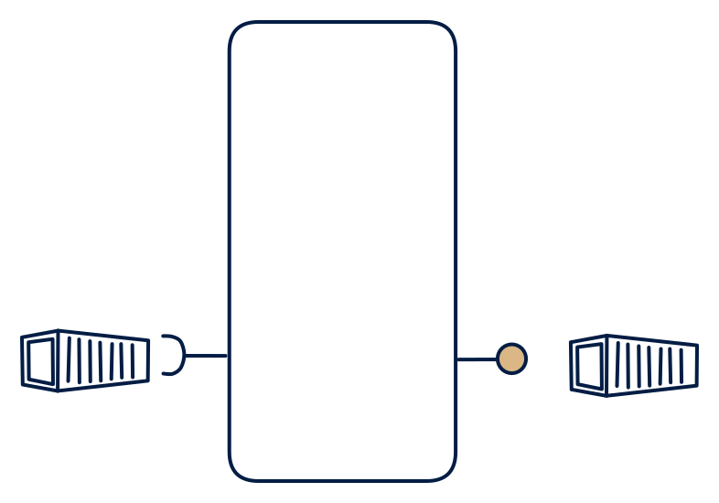

# 7.7 — The pure ETL file product

**Interface:** IN `{B}` → OUT `{B}`&emsp;&emsp;**Verdict:** common

Files in → files out. The original data product: transformation + publication, no serving stack beyond the file contract (any "settlement input bundle" product). Every publication is a self-contained artifact: the file *is* the product, and there is no state to keep between loads. A diagonal cell (IN = OUT): the value sits in normalisation, reconciliation and publication — a trustworthy file over messier sources.

## When to use

The contract is a file and the load is scheduled; the cheapest possible product.

The canonical case: a counterparty tariff or interval file, loaded, reconciled, and republished for settlement or reporting.

## What's inside

- A scheduled **ingest job** (pickup/landing, parse, validate, load).
- A **transform layer** — the only real engine: normalisation, reconciliation, rollups.
- A **publication step** that builds and places the artifact, with a manifest/checksum and supersession rule.

## State & cost

Minimal state by design: a working store sized for one cycle, plus the last published artifact for re-issue. Cost scales with artifact size times retention, not with volume. Cheapest cell in the space to operate.

## Watch out

No live semantics at all — publish with explicit as-of.

- Late files and corrections: supersession semantics (replace, re-version, or append) must be explicit in the contract.
- No liveness at all — consumers must never read "missing" as "unchanged"; the as-of stamp is the contract.

## Typical next step

Two natural growths: an online consumer appears, and the product adds a query surface over the same store (**cell 7.6**, or **7.2** when a file is also kept); a change-reactive consumer appears, and a refresh-derived change feed (a synthetic stream) is added — **cells 7.4**/**7.5**. If the source world itself gains an API or a push feed, the product migrates up a row to **6.x** or **4.x**.

## Verdict

**common** — the workhorse of regulated, file-anchored domains — cheap to run and the most load-bearing contract where settlement is defined in files.

## Related

* [batch](/knowledge-concepts/pattern-batch)
* [data-product](/knowledge-concepts/data-product) — the overall model
* [verdict](/knowledge-concepts/verdict) — what the common / plausible / niche tag means
* [architectural paradigms](/knowledge-concepts/architectural-paradigms) — this cell maps to: ETL / ELT / data warehouse: the classic batch pipeline, files in, files out.
