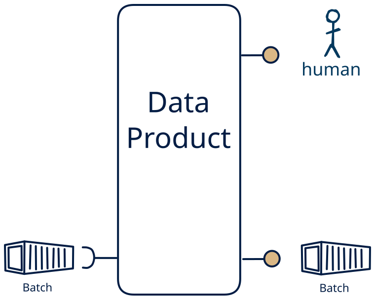

# 7.14 — batch-only → file + human

**Interface:** IN {B} → OUT {B, H}&emsp;&emsp;**Verdict:** common

A product that takes files (batch) and serves bulk files and a human-facing surface (dashboard/report). Machine-side inputs ({B}) drive it — the multi-surface serves people, not just machines.

## When to use

The data the audience wants is real, but the reader is a person, not a service: they need a report or dashboard over a single leg of bulk files, not raw events or a bulk drop.

## What's inside

- Ingest: a scheduled **bulk ingest** (pickup, parse, validate, load).
- Core: a light transform between ingest and serve
- Serve: a **publication job** that materialises bulk artifacts (files/bundles) with a manifest and as-of and a **human-facing surface** (dashboard, report, printout, or review screen) — the layer people actually read.
- State: a durable **state store** and the **retained bulk artifacts**.

## State & cost

Dominated by the durable state store (grows with entity/state breadth) and the retained bulk artifacts.

## Watch out

- A human-facing surface inherits the state behind it: the report/dashboard carries every as-of and correctness rule of the store, and a person spots a stale number faster than an API client will.
- A published file is a **completeness claim**: a manifest-first publish and a supersession rule belong in the contract.
- This is machine-produced, human-read: make sure a person actually reviews/approves the served view rather than the pipeline writing it straight through.

## Typical next step

add **human curation on the input side** → cell [14.14](/data-product-types/in-bh-out-bh) when the data should not be purely machine-fed, add a **query API** → cell [7.9](/data-product-types/in-b-out-bhr), and add a **feed** → cell [7.10](/data-product-types/in-b-out-bhs) (a *synthetic* stream, since S is absent from IN); or the source world gains a leg this product does not yet take, and it migrates to a richer IN-state on the same row.

## Verdict

**common** — A product that ingests bulk files and serves bulk files plus a human-facing surface (a dashboard, report, or review). It is the right shape where the reader is a person rather than a service, and the human-shaped view is itself what the next consumer — or the next machine in the loop — needs to act on.

## Related

* [batch](/knowledge-concepts/pattern-batch)
* [human](/knowledge-concepts/pattern-human)
* [data-product](/knowledge-concepts/data-product) — the overall model
* [verdict](/knowledge-concepts/verdict) — what the common / plausible / niche tag means
