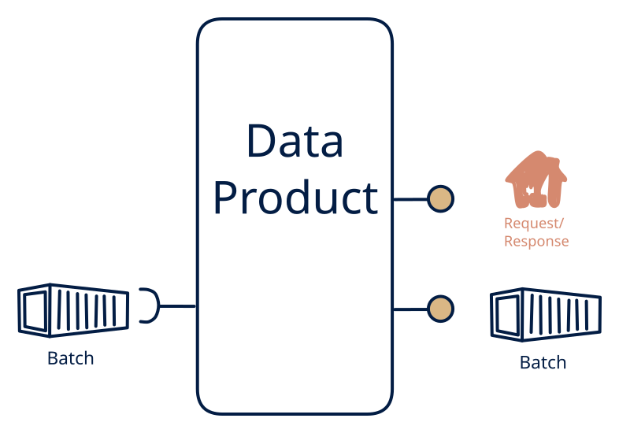

# 7.2 — The classic data warehouse

**Interface:** IN `{B}` → OUT `{B, R}`&emsp;&emsp;**Verdict:** common

Files in → API + files out. Standard ETL/ELT target that also serves a query API on top (EOD price files → price API + downstream files). This is the classic data warehouse: one durable state (the store) with two surfaces over it — a query API and file publication. Off-diagonal: the conversion is real, a batch world made queryable.

## When to use

Consumers need both an analytical API and bulk delivery; upstream is batch.

The canonical utility case: EOD price or tariff files in; a price API and downstream settlement files out.

## What's inside

- The same scheduled **ingest + transform** as cell 7.7, loading into a warehouse-style **state store**.
- A **query service** (API) over the store — the online surface.
- A **publication job** that materialises the store as files for bulk consumers.
- The store, the load history, and the last publication are the only durable state.

## State & cost

The state store is the cost centre: it grows with the data's breadth and depth, and retention policy is a standing decision. The file side adds artifact storage on top. Heavier than 7.7, but the API surface is what consumers usually pay for.

## Watch out

- The API and the files must agree as of the same load — derive both from the same committed state, or the two surfaces drift apart.
- Intra-day source updates are invisible to consumers; the store is flat between loads, so the as-of must be surfaced everywhere.

## Typical next step

The standard growth is liveness: when a consumer needs to react to changes, the product adds a refresh-derived change feed and becomes **cell 7.1** — the classic "warehouse grows a live view" path. Adding more inputs (an API source, a push feed) migrates the product to row **2** or **4**.

## Verdict

**common** — the classic settlement-core shape: batch in, query plus files out — it carries the bulk of regulated utility and market data traffic.

## Related

* [batch](/concepts/pattern-batch)
* [request/response](/concepts/pattern-request-response)
* [data-product](/concepts/data-product) — the overall model
* [verdict](/concepts/verdict) — what the common / plausible / niche tag means
* [architectural paradigms](/concepts/architectural-paradigms) — this cell maps to: ETL / ELT / data warehouse: the classic warehouse — batch in, query + file out.
