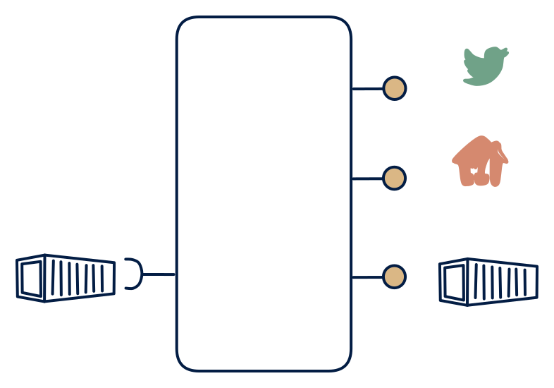

# 7.1 — Batch-loaded platform with all out

**Interface:** IN `{B}` → OUT `{B, R, S}`&emsp;&emsp;**Verdict:** plausible

A nightly-loaded warehouse that also serves a (CDC or refresh-derived) stream + API + files. The full platform over a batch world: file in, everything out. The stream surface is the interesting part — it is a synthetic stream computed by detecting changes between refreshes, not a native feed.

## When to use

Full consumer mix is needed, but the source world is batch-only.

Chosen when downstream spans all three consumer families — event-driven, online, and bulk — but the source world only ever publishes files.

## What's inside

- Scheduled **ingest + transform** into a state store (the warehouse core).
- A **change-detection layer** over the store: each refresh is diffed, and the delta is emitted as events (the synthetic feed).
- Three serving stacks: a **producer** (live feed), a **query service** (API), and a **publication job** (files).
- State: the store, the diff baseline (last snapshot), the feed log, and the last artifact.

## State & cost

The heaviest batch-anchored cell: state store plus synthetic-feed log plus full-snapshot artifacts. All three serving stacks are paid for, and the diff engine adds per-cycle compute. Met when all three consumer families are real — rare, but expensive to fake.

## Watch out

The "stream out" is synthetic (CDC on a refreshed table) — make the semantics explicit.

- The feed is synthetic: "change" is a diff between refreshes, so latency is bounded by the load cadence and late data produces spurious or missing events unless windowed explicitly.
- Three surfaces over one store means three failure modes to explain to three different consumers; consistency across surfaces must be contract, not luck.

## Synthetic stream

This cell's stream **out** is not backed by a stream **in** — it is a **synthetic stream**: change-detection computed on top of a non-streaming source. The contract must pin down five things (see [synthetic stream](/concepts/synthetic-stream)):

1. **What counts as a "change"** — field-level, row version, or full snapshot?
2. **Latency bound** — bounded by the poll/refresh cadence, not the source's event time.
3. **Idempotency** — re-polling / re-loading must not duplicate events.
4. **Backfill semantics** — how history is (re)issued after a gap or correction.
5. **Ordering** — whether the stream preserves source ordering at all.

## Typical next step

Pattern space at this corner is exhausted; growth is horizontal — new domains or tenants fed through the same platform, or a source-side upgrade (a feed replaces the file) that simplifies the product toward row **4**. Dropping the feed (the most costly surface usually) yields **7.2**; that is the common *contraction*, not the growth.

## Verdict

**plausible** — plausible as the full-surface batch platform — met only where all three consumer families are real and the source stays batch-only.

## Related

* [batch](/concepts/pattern-batch)
* [request/response](/concepts/pattern-request-response)
* [streaming](/concepts/pattern-streaming)
* [synthetic-stream](/concepts/synthetic-stream) — this cell's stream out is not backed by a stream in
* [data-product](/concepts/data-product) — the overall model
* [verdict](/concepts/verdict) — what the common / plausible / niche tag means
