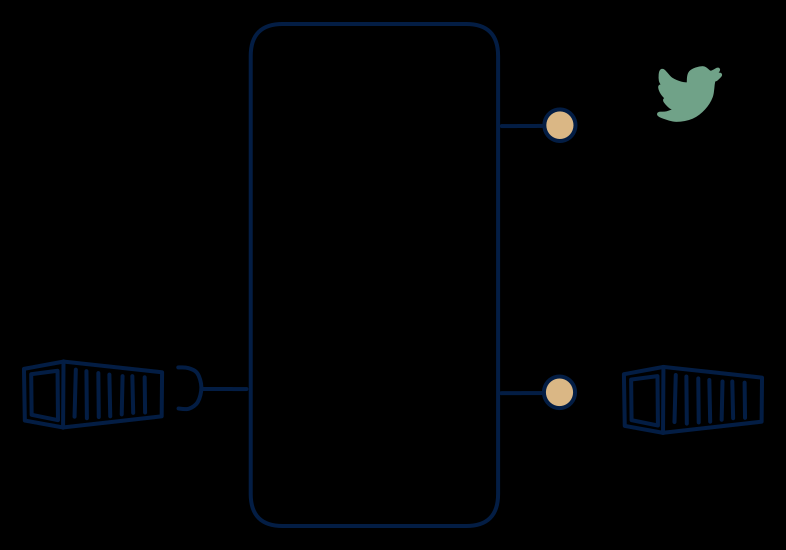

# 7.3 — Batch data, stream + files out

**Interface:** IN `{B}` → OUT `{B, S}`&emsp;&emsp;**Verdict:** niche

Nightly load + a stream out (CDC from the refreshed table — a pseudo-stream).

## When to use

Consumers want to react to change but the upstream only publishes files.

## Watch out

Latency = batch cadence; document clearly.

## Related

* [batch](/knowledge-concepts/pattern-batch)
* [streaming](/knowledge-concepts/pattern-streaming)
* [synthetic-stream](/knowledge-concepts/synthetic-stream) — this cell's stream out is not backed by a stream in
* [data-product](/knowledge-concepts/data-product) — the overall model
* [verdict](/knowledge-concepts/verdict) — what the common / plausible / niche tag means
* [architectural paradigms](/knowledge-concepts/architectural-paradigms) — this cell maps to: CDC (change data capture): a batch-refreshed store emits a synthetic stream + archive.

