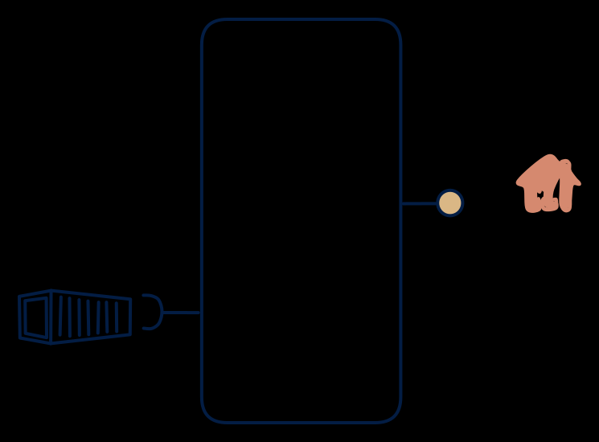

# 7.6 — The classic "load files, serve API"

**Interface:** IN `{B}` → OUT `{R}`&emsp;&emsp;**Verdict:** common

Files in → one clean API out (nightly price/tariff files → price/tariff API). The most common single-pattern data product in regulated/utility domains. The classic "load files, serve API" product: a durable state store with a query API as its only surface. Off-diagonal, and usually the first data product an organisation builds over counterparty files.

## When to use

Upstream is file-based, consumers are online.

The most common single-pattern product in regulated/utility domains: nightly price, tariff, or master-data files in; one clean API out.

## What's inside

- Scheduled **ingest + validation + load** into a **state store**.
- A **query service** (the sole serving surface) with auth, pagination, and the as-of stamp.
- State: the store plus the load history. No logs, no artifacts besides the last load.

## State & cost

A single state store sized for the current (usually last N) loads — the dominant cost. No feed, no full-snapshot archives: cheaper than 7.7 per unit of served data when consumers only query. The store's retention policy is the quiet budget line.

## Watch out

- The API is only as fresh as the last load: consumers will assume "now" unless the as-of stamp is explicit and unmissable.
- Load failures are silent staleness, not downtime — monitoring must distinguish "no data" from "stale data".

## Typical next step

Natural growth: file consumers appear and the product adds bulk publication (**cell 7.2**); change-reactive consumers appear and a refresh-derived feed is added (**7.4**). A source-side feed or API migrates the product toward **row 3**/**row 4**.

## Verdict

**common** — the most common single-pattern product in regulated/utility domains — the default first data product over counterparty files.

## Related

* [batch](/knowledge-concepts/pattern-batch)
* [request/response](/knowledge-concepts/pattern-request-response)
* [data-product](/knowledge-concepts/data-product) — the overall model
* [verdict](/knowledge-concepts/verdict) — what the common / plausible / niche tag means
