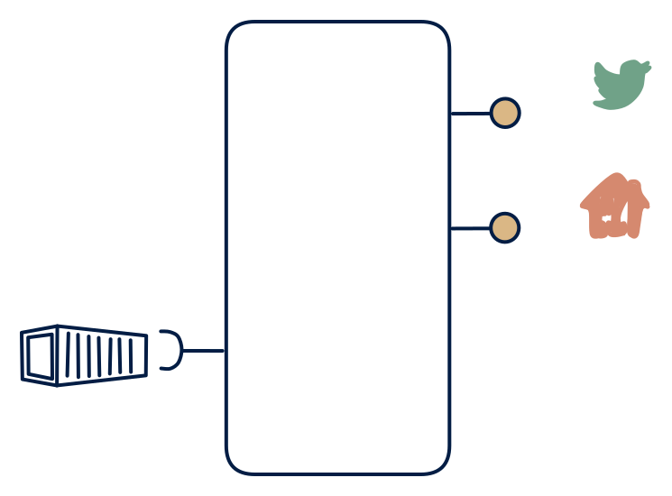

# 7.4 — Batch → live query + pseudo-events

**Interface:** IN `{B}` → OUT `{R, S}`&emsp;&emsp;**Verdict:** niche

Serve "live" over a nightly refresh: events (synthetic) + query API from batch inputs.

## When to use

Consumers are online and events-only; the source is batch.

## Watch out

"Live" is an illusion — label it "as-of last refresh".

## Related

* [batch](/knowledge-concepts/pattern-batch)
* [request/response](/knowledge-concepts/pattern-request-response)
* [streaming](/knowledge-concepts/pattern-streaming)
* [synthetic-stream](/knowledge-concepts/synthetic-stream) — this cell's stream out is not backed by a stream in
* [data-product](/knowledge-concepts/data-product) — the overall model
* [verdict](/knowledge-concepts/verdict) — what the common / plausible / niche tag means
* [architectural paradigms](/knowledge-concepts/architectural-paradigms) — this cell maps to: CDC (change data capture): a batch-refreshed store emits a synthetic stream + query API.

