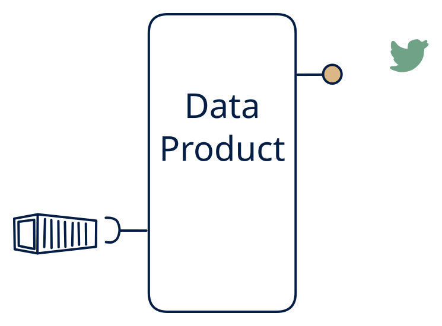

# 7.5 — Batch → event feed

**Interface:** IN `{B}` → OUT `{S}`&emsp;&emsp;**Verdict:** niche

Turn a daily bulk load into a stream of events (snapshots → deltas) — a *replay* product. The purest synthetic-stream cell over a batch source: files in, a change feed out, and nothing else. The product's entire value is the feed — and the feed is manufactured, not received.

## When to use

Downstream is a pure event world and the source is a legacy batch world.

A legacy batch world feeding a stream-driven estate: the consumer architecture is Kafka-first, but the source only publishes files.

## What's inside

- Scheduled **ingest** of files into a working store.
- A **diff engine** comparing successive snapshots (or a CDC-style replay of the last load).
- A **producer** emitting the synthetic change feed.
- State: the working store (last snapshot) plus the diff baseline.

## State & cost

A working store sized for the full snapshot, plus the feed log's retention. No query store, no artifact publication — the state cost is dominated by the snapshot itself, which the diff engine must keep whole.

## Watch out

Consumers must treat each batch as a batch of synthetic events, not a continuous feed.

- Consumers may expect push semantics the source cannot honour: document deltas vs snapshots, the refresh gap between events, and backfill rules explicitly.
- Full-reload semantics: a corrected or re-issued source file may re-emit large event bursts; consumers must be idempotent per key, not per event.

## Synthetic stream

This cell's stream **out** is not backed by a stream **in** — it is a **synthetic stream**: change-detection computed on top of a non-streaming source. The contract must pin down five things (see [synthetic stream](/concepts/synthetic-stream)):

1. **What counts as a "change"** — field-level, row version, or full snapshot?
2. **Latency bound** — bounded by the poll/refresh cadence, not the source's event time.
3. **Idempotency** — re-polling / re-loading must not duplicate events.
4. **Backfill semantics** — how history is (re)issued after a gap or correction.
5. **Ordering** — whether the stream preserves source ordering at all.

## Typical next step

Growth is almost always the missing surfaces: add the query API (**cell 7.4** or **7.6**) or the files (**7.3**). A source-side feed migrates the product to **row 5**/**row 4** and usually retires the synthetic machinery entirely — that is the best long-run outcome.

## Verdict

**niche** — plausible as a batch-to-stream bridge; it is a deliberate, high-ops-cost choice, not a default.

## Related

* [batch](/concepts/pattern-batch)
* [streaming](/concepts/pattern-streaming)
* [synthetic-stream](/concepts/synthetic-stream) — this cell's stream out is not backed by a stream in
* [data-product](/concepts/data-product) — the overall model
* [verdict](/concepts/verdict) — what the common / plausible / niche tag means
* [architectural paradigms](/concepts/architectural-paradigms) — this cell maps to: CDC (change data capture): a batch-refreshed store emits a synthetic change stream.
