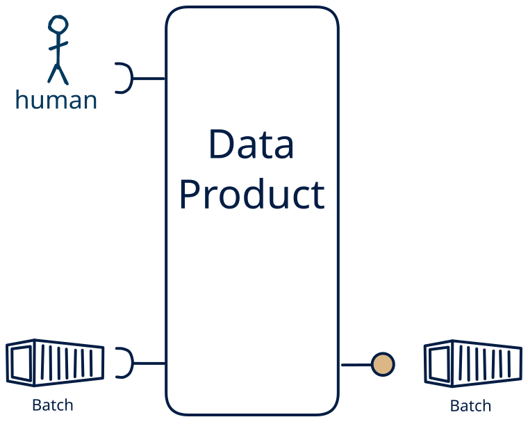

# 14.7 — file + human → batch-only

**Interface:** IN {B, H} → OUT {B}&emsp;&emsp;**Verdict:** plausible

A product that takes files (batch) and human-produced data and serves bulk files. Human-entered data is one leg of the source, alongside files; the product carries that mix through to bulk files.

## When to use

The data is partly human-curated, alongside files, and the audience needs it as bulk files — the product is the layer between a person's editing and the consumer.

## What's inside

- Ingest: a scheduled **bulk ingest** (pickup, parse, validate, load) and **human entry / curation** — data produced by people (forms, editors, review UIs), validated and audit-trailed on every change.
- Core: a **merge layer** that unifies human-entered data with the machine legs into one canonical view
- Serve: a **publication job** that materialises bulk artifacts (files/bundles) with a manifest and as-of.
- State: a durable **state store**, the **retained bulk artifacts**, and an **audit trail** of human changes.

## State & cost

Dominated by the durable state store (grows with entity/state breadth), the retained bulk artifacts, and the audit trail of human edits.

## Watch out

- **Softness is a cost, not a value judgement.** Human-entered data is the softest input — irregular, subjective, error-prone, expensive to re-issue — so it needs **validation, provenance, and a correction path**, and trust leans on the audit trail, not the schedule. It is also the most expensive channel: where a machine source *can* carry the same meaning, prefer it, and keep the human leg for what only a person can supply.
- **Human input can be the value-driver.** Where the human act *is* the value — a judgement, a design intent, creative or social content, an accountable decision — and cannot be automated, human input is the **most valuable input** the product has, and the other legs exist to *enrich* it (see [the role of human input](/concepts/role-of-human-input)).
- A published file is a **completeness claim**: a manifest-first publish and a supersession rule belong in the contract.

## Typical next step

add a **human-facing surface** → cell [14.14](/data-product-types/in-bh-out-bh), add a **query API** → cell [14.2](/data-product-types/in-bh-out-br), and add a **feed** → cell [14.3](/data-product-types/in-bh-out-bs) (synthetic only if the human change is observed state rather than delivered actions — see [synthetic stream](/concepts/synthetic-stream)); or the source world gains a leg this product does not yet take, and it migrates to a richer IN-state on the same row.

## Verdict

**plausible** — A product that ingests human input layered on top of bulk files and serves bulk files. It is a deliberate, project-shaped choice — not a default pipe — because human input is the softest and costliest channel, so where the value *could* be automated the machine path is preferred; where the human act *is* the irreplaceable value it is the most valuable input the product has and the machine legs exist to *enrich* it.

## Related

* [batch](/concepts/pattern-batch)
* [human](/concepts/pattern-human)
* [data-product](/concepts/data-product) — the overall model
* [verdict](/concepts/verdict) — what the common / plausible / niche tag means
