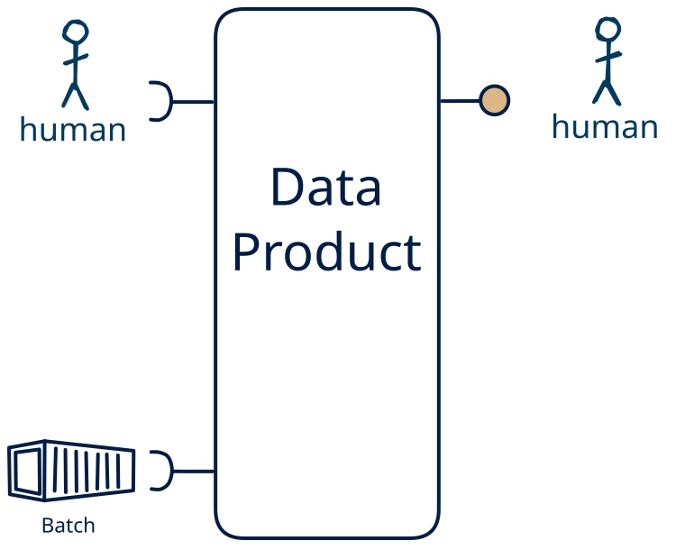

# 14.15 — file + human → human-only

**Interface:** IN {B, H} → OUT {H}&emsp;&emsp;**Verdict:** plausible

A product that takes files (batch) and human-produced data and serves a human-facing surface (dashboard/report). People both produce and read the data: the human pattern is on both sides.

## When to use

A small group of people both maintains and reads the data, with no machine consumer — a shared, human-scale record rather than an automated interface.

## What's inside

- Ingest: a scheduled **bulk ingest** (pickup, parse, validate, load) and **human entry / curation** — data produced by people (forms, editors, review UIs), validated and audit-trailed on every change.
- Core: a **merge layer** that unifies human-entered data with the machine legs into one canonical view
- Serve: a **human-facing surface** (dashboard, report, printout, or review screen) — the layer people actually read.
- State: a durable **state store** and an **audit trail** of human changes.

## State & cost

Dominated by the durable state store (grows with entity/state breadth) and the audit trail of human edits. Serving people is cheap to run and cheap to trust — a presentation layer over a queryable backend.

## Watch out

- **Softness is a cost, not a value judgement.** Human-entered data is the softest input — irregular, subjective, error-prone, expensive to re-issue — so it needs **validation, provenance, and a correction path**, and trust leans on the audit trail, not the schedule. It is also the most expensive channel: where a machine source *can* carry the same meaning, prefer it, and keep the human leg for what only a person can supply.
- **Human input can be the value-driver.** Where the human act *is* the value — a judgement, a design intent, creative or social content, an accountable decision — and cannot be automated, human input is the **most valuable input** the product has, and the other legs exist to *enrich* it (see [the role of human input](/knowledge-concepts/role-of-human-input)).
- A human-facing surface inherits the state behind it: the report/dashboard carries every as-of and correctness rule of the store, and a person spots a stale number faster than an API client will.

## Typical next step

add a **query API** → cell [14.13](/data-product-types/in-bh-out-rh), add a **bulk file** → cell [14.14](/data-product-types/in-bh-out-bh), and add a **feed** → cell [14.12](/data-product-types/in-bh-out-sh) (synthetic only if the human change is observed state rather than delivered actions — see [synthetic stream](/knowledge-concepts/synthetic-stream)); or the source world gains a leg this product does not yet take, and it migrates to a richer IN-state on the same row.

## Verdict

**plausible** — A product that ingests human input layered on top of bulk files and serves a human-facing surface (a report, dashboard, or shared record the same people maintain). It is a natural fit where the human act *is* the value — a judgement, a decision, a curated record — so the softest, costliest channel is then the *cost of having that value*; where the act *could* be automated the cheaper machine path wins.

## Related

* [batch](/knowledge-concepts/pattern-batch)
* [human](/knowledge-concepts/pattern-human)
* [data-product](/knowledge-concepts/data-product) — the overall model
* [verdict](/knowledge-concepts/verdict) — what the common / plausible / niche tag means
