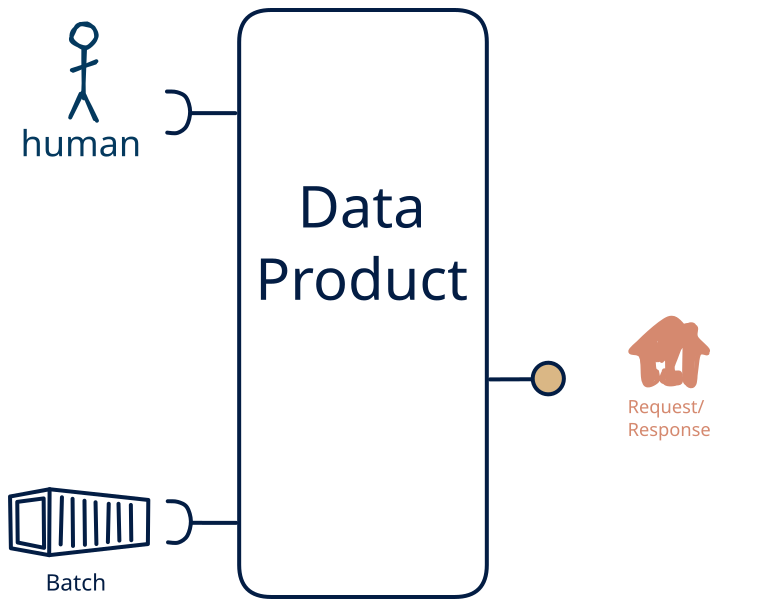

# 14.6 — file + human → request-response-only

**Interface:** IN {B, H} → OUT {R}&emsp;&emsp;**Verdict:** plausible

A product that takes files (batch) and human-produced data and serves a query API. Human-entered data is one leg of the source, alongside files; the product carries that mix through to a query API.

## When to use

The data is partly human-curated, alongside files, and the audience needs it as a query API — the product is the layer between a person's editing and the consumer.

## What's inside

- Ingest: a scheduled **bulk ingest** (pickup, parse, validate, load) and **human entry / curation** — data produced by people (forms, editors, review UIs), validated and audit-trailed on every change.
- Core: a **merge layer** that unifies human-entered data with the machine legs into one canonical view
- Serve: a **query service** (the API surface) over the state store.
- State: a durable **state store** and an **audit trail** of human changes.

## State & cost

Dominated by the durable state store (grows with entity/state breadth) and the audit trail of human edits.

## Watch out

- Human-entered data is the softest input: it arrives irregularly, carries intent and errors, and needs **validation, provenance, and a correction path** — trust leans on the audit trail, not the schedule.

## Typical next step

add a **human-facing surface** → cell [14.13](/data-product-types/in-bh-out-rh), add a **bulk file** → cell [14.2](/data-product-types/in-bh-out-br), and add a **feed** → cell [14.4](/data-product-types/in-bh-out-rs) (a *synthetic* stream, since S is absent from IN); or the source world gains a leg this product does not yet take, and it migrates to a richer IN-state on the same row.

## Verdict

**plausible** — turning human-entered data into a downstream surface is sensible but project-shaped — a curation product, not a default pipe, and its demand is real where this audience exists.

## Related

* [batch](/knowledge-concepts/pattern-batch)
* [request/response](/knowledge-concepts/pattern-request-response)
* [human](/knowledge-concepts/pattern-human)
* [data-product](/knowledge-concepts/data-product) — the overall model
* [verdict](/knowledge-concepts/verdict) — what the common / plausible / niche tag means
