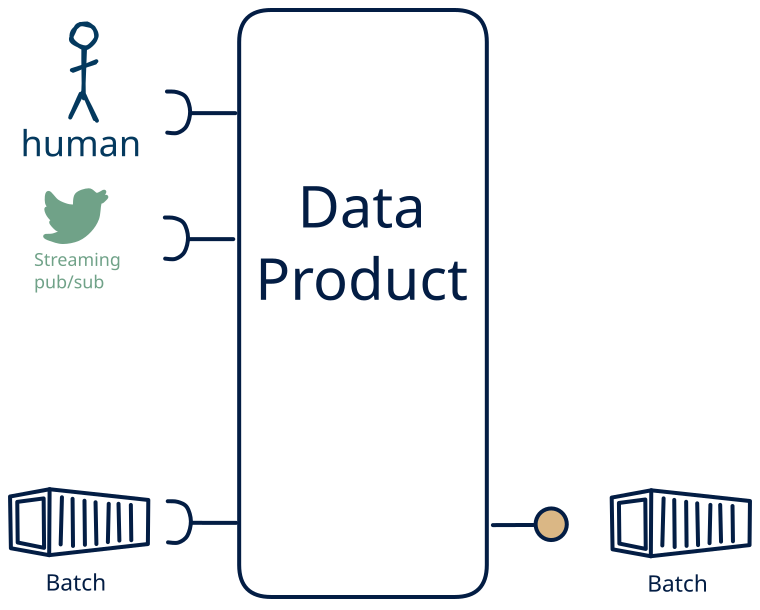

# 10.7 — file/stream + human → batch-only

**Interface:** IN {B, S, H} → OUT {B}&emsp;&emsp;**Verdict:** plausible

A product that takes files (batch), live streams, and human-produced data and serves bulk files. Human-entered data is one leg of the source, alongside files and live streams; the product carries that mix through to bulk files.

## When to use

The data is partly human-curated, alongside files and live streams, and the audience needs it as bulk files — the product is the layer between a person's editing and the consumer.

## What's inside

- Ingest: a scheduled **bulk ingest** (pickup, parse, validate, load), a **stream consumer** (offsets, replay) for the live leg, and **human entry / curation** — data produced by people (forms, editors, review UIs), validated and audit-trailed on every change.
- Core: a **fold/aggregation core** that folds the live leg into queryable state or windowed files and a **merge layer** that unifies human-entered data with the machine legs into one canonical view
- Serve: a **publication job** that materialises bulk artifacts (files/bundles) with a manifest and as-of.
- State: a durable **state store**, the **feed log** (retention), the **retained bulk artifacts**, and an **audit trail** of human changes.

## State & cost

Dominated by the durable state store (grows with entity/state breadth), the retained bulk artifacts, and the audit trail of human edits.

## Watch out

- Human-entered data is the softest input: it arrives irregularly, carries intent and errors, and needs **validation, provenance, and a correction path** — trust leans on the audit trail, not the schedule.
- **Mixed time bases** in the inputs (live vs. poll/cycle/human): fix the authoritative as-of per surface, or each output looks correct alone and wrong cross-checked.
- Late and out-of-order events are a **first-class** question: a watermark and a re-issue/correction rule, or history gains holes and duplicate facts.
- A published file is a **completeness claim**: a manifest-first publish and a supersession rule belong in the contract.

## Typical next step

add a **human-facing surface** → cell [10.14](/data-product-types/in-bhs-out-bh), add a **query API** → cell [10.2](/data-product-types/in-bhs-out-br), and add a **feed** → cell [10.3](/data-product-types/in-bhs-out-bs); or the source world gains a leg this product does not yet take, and it migrates to a richer IN-state on the same row.

## Verdict

**plausible** — turning human-entered data into a downstream surface is sensible but project-shaped — a curation product, not a default pipe, and its demand is real where this audience exists.

## Related

* [batch](/knowledge-concepts/pattern-batch)
* [streaming](/knowledge-concepts/pattern-streaming)
* [human](/knowledge-concepts/pattern-human)
* [data-product](/knowledge-concepts/data-product) — the overall model
* [verdict](/knowledge-concepts/verdict) — what the common / plausible / niche tag means
