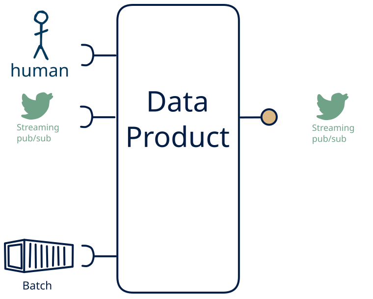

# 10.5 — file/stream + human → stream-only

**Interface:** IN {B, S, H} → OUT {S}&emsp;&emsp;**Verdict:** plausible

A product that takes files (batch), live streams, and human-produced data and serves a live feed. Human-entered data is one leg of the source, alongside files and live streams; the product carries that mix through to a live feed.

## When to use

The data is partly human-curated, alongside files and live streams, and the audience needs it as a live feed — the product is the layer between a person's editing and the consumer.

## What's inside

- Ingest: a scheduled **bulk ingest** (pickup, parse, validate, load), a **stream consumer** (offsets, replay) for the live leg, and **human entry / curation** — data produced by people (forms, editors, review UIs), validated and audit-trailed on every change.
- Core: a **transform** (filter/shape/route) over the live leg and a **merge layer** that unifies human-entered data with the machine legs into one canonical view
- Serve: a **producer** re-exposing the (transformed) live feed.
- State: a durable **state store**, the **feed log** (retention), and an **audit trail** of human changes.

## State & cost

Dominated by the durable state store (grows with entity/state breadth), the input and output feed logs, and the audit trail of human edits.

## Watch out

- **Softness is a cost, not a value judgement.** Human-entered data is the softest input — irregular, subjective, error-prone, expensive to re-issue — so it needs **validation, provenance, and a correction path**, and trust leans on the audit trail, not the schedule. It is also the most expensive channel: where a machine source *can* carry the same meaning, prefer it, and keep the human leg for what only a person can supply.
- **Human input can be the value-driver.** Where the human act *is* the value — a judgement, a design intent, creative or social content, an accountable decision — and cannot be automated, human input is the **most valuable input** the product has, and the other legs exist to *enrich* it (see [the role of human input](/concepts/role-of-human-input)).
- **Mixed time bases** in the inputs (live vs. poll/cycle/human): fix the authoritative as-of per surface, or each output looks correct alone and wrong cross-checked.

## Typical next step

add a **human-facing surface** → cell [10.12](/data-product-types/in-bhs-out-sh), add a **query API** → cell [10.4](/data-product-types/in-bhs-out-rs), and add a **bulk file** → cell [10.3](/data-product-types/in-bhs-out-bs); or the source world gains a leg this product does not yet take, and it migrates to a richer IN-state on the same row.

## Verdict

**plausible** — A product that ingests human input layered on top of bulk files and live feeds and serves live feeds. It is a deliberate, project-shaped choice — not a default pipe — because human input is the softest and costliest channel, so where the value *could* be automated the machine path is preferred; where the human act *is* the irreplaceable value it is the most valuable input the product has and the machine legs exist to *enrich* it.

## Related

* [batch](/concepts/pattern-batch)
* [streaming](/concepts/pattern-streaming)
* [human](/concepts/pattern-human)
* [data-product](/concepts/data-product) — the overall model
* [verdict](/concepts/verdict) — what the common / plausible / niche tag means
