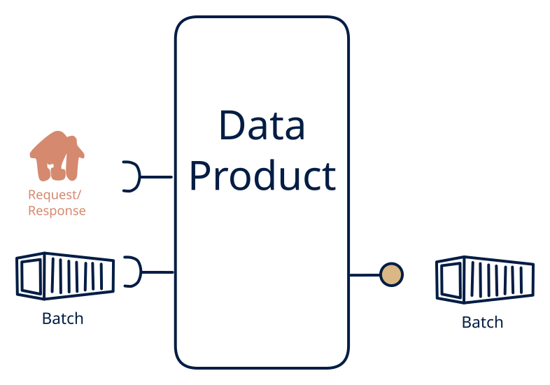

# 2.7 — The classic ETL

**Interface:** IN `{B, R}` → OUT `{B}`&emsp;&emsp;**Verdict:** common

Files + APIs in → file(s) out. The oldest and most common data product that exists (supplier feeds + master APIs → settlement/report files). Files and an API in, a file out: the classic ETL consolidation. The product merges two reference-world inputs (a batch feed plus a polled or static API) into one canonical artifact.

## When to use

The contract with consumers is a file on a schedule.

The contract is a consolidated file (a joined master, a rate card, a reconciliation bundle) where one input is a batch feed and the other is an API or a static reference.

## What's inside

- A **batch loader** for the file leg plus a **poller/connector** (anchor) for the API leg.
- A **merge/transform** that reconciles the two inputs into the canonical model (join on a shared key, apply precedence).
- A **publication** that assembles and places the consolidated file with its as-of.
- State: the merged working store for the cycle, the API anchor, and the published files.

## State & cost

Bounded working state (one cycle's merge) plus the API anchor plus file retention. No persistent query store, no feed — the state cost is the transient merge store and the artifacts. Cheaper than a 2.2 (no query store) and comparable to a 7.7 with an extra input leg.

## Watch out

- The merge is a decision, not a computation: which input wins a conflict (the feed vs the API), and on which key, must be stated; a silent precedence rule is a data-quality incident waiting to happen.
- The API leg is polled, the file leg is loaded: the two as-of times can differ for the same record, and the consolidated file must carry the as-of that determines truth.

## Typical next step

Natural growths: a query consumer appears and a read model/API over the merged state is added — **cell 2.2**; a change-reactive consumer appears and a synthetic change feed is layered on — **2.1**/**2.3**. A push feed replacing the API leg moves the product to **row 4**; a second file leg replacing the API leg moves it to **row 1**.

## Verdict

**common** — the classic ETL consolidation — a common, defensible shape where two reference inputs (batch plus API) must merge into one canonical file.

## Related

* [batch](/concepts/pattern-batch)
* [request/response](/concepts/pattern-request-response)
* [data-product](/concepts/data-product) — the overall model
* [verdict](/concepts/verdict) — what the common / plausible / niche tag means
