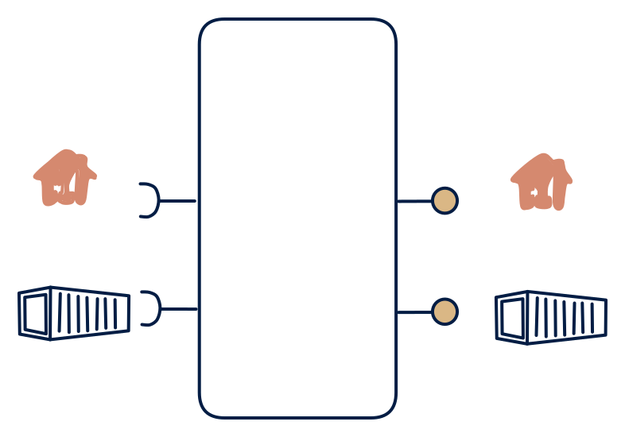

# 2.2 — Classic data API + file feed

**Interface:** IN `{B, R}` → OUT `{B, R}`&emsp;&emsp;**Verdict:** common

The bread and butter: refresh from feeds and APIs, serve a clean API plus daily bundles (a weather/price API that also serves files).

## When to use

Consumers are a mix of online pollers and ETL consumers; no live requirement.

## Related

* [batch](/knowledge-concepts/pattern-batch)
* [request/response](/knowledge-concepts/pattern-request-response)
* [data-product](/knowledge-concepts/data-product) — the overall model
* [verdict](/knowledge-concepts/verdict) — what the common / plausible / niche tag means

