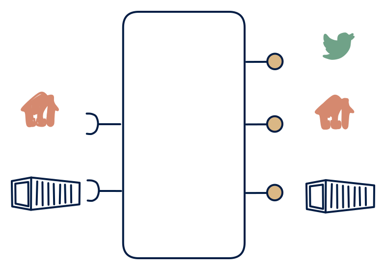

# 2.1 — Refreshed model serving all three out

**Interface:** IN `{B, R}` → OUT `{B, R, S}`&emsp;&emsp;**Verdict:** plausible

A polled/file-fed state store that publishes a *synthetic* change stream in addition to API + files. Files and an API in; API, files, and a change feed out: the full-surface reference hub. The feed is a synthetic change stream computed from the refresh, not a native input.

## When to use

Consumers need events, but the source world only offers files/APIs — the product computes change detection.

A reference/master-data hub where consumers span all three families — online query, bulk file, and event-driven reaction — but the source is batch plus API only.

## What's inside

- A **batch loader** plus a **poller/connector** (anchor) feeding a **canonical store**.
- A **merge/transform** reconciling the two inputs into the canonical model.
- A **change-detection layer** over the store (refresh N vs N-1) driving a **producer** (the synthetic feed).
- A **query service** (API) and a **publication job** (file) over the store.
- State: the canonical store, the anchor, the diff baseline, the feed log, and the last artifact.

## State & cost

Heaviest cell of row 2: canonical store plus diff baseline plus feed log plus artifacts, all maintained from two input legs. The synthetic feed is the expensive-to-trust part; the rest is a standard hub with an extra change layer.

## Watch out

Streams derived from polling are chatty and lossy-ish; define "change" semantics explicitly.

- The feed's "change" is a diff between refreshes: a change that occurs and reverts within one refresh is invisible to feed consumers, and a correction re-issues as a burst — both are semantic gaps to document.
- Three surfaces over one store mean one bad merge or a stale anchor degrades the API, the file, and the feed simultaneously; the anchor and the diff baseline are load-bearing shared state.

## Synthetic stream

This cell's stream **out** is not backed by a stream **in** — it is a **synthetic stream**: change-detection computed on top of a non-streaming source. The contract must pin down five things (see [synthetic stream](/concepts/synthetic-stream)):

1. **What counts as a "change"** — field-level, row version, or full snapshot?
2. **Latency bound** — bounded by the poll/refresh cadence, not the source's event time.
3. **Idempotency** — re-polling / re-loading must not duplicate events.
4. **Backfill semantics** — how history is (re)issued after a gap or correction.
5. **Ordering** — whether the stream preserves source ordering at all.

## Typical next step

At this corner the pattern space is exhausted; growth is horizontal (more reference domains, more tenants) or an input-side maturation — a push feed replacing the API leg, which migrates the product toward **row 4** and retires the diff machinery. The common contraction is dropping the feed, yielding **2.2**.

## Verdict

**plausible** — the canonical full-surface reference hub — a plausible, defensible, but expensive shape, met where all three consumer families are real over a batch-plus-API source.

## Related

* [batch](/concepts/pattern-batch)
* [request/response](/concepts/pattern-request-response)
* [streaming](/concepts/pattern-streaming)
* [synthetic-stream](/concepts/synthetic-stream) — this cell's stream out is not backed by a stream in
* [data-product](/concepts/data-product) — the overall model
* [verdict](/concepts/verdict) — what the common / plausible / niche tag means
