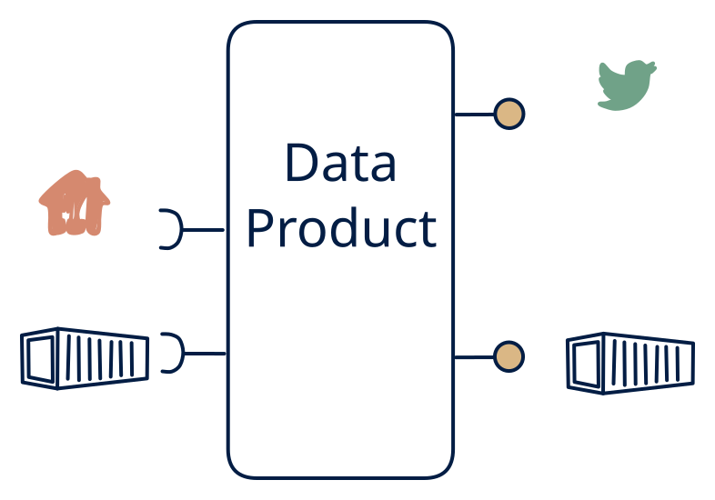

# 2.3 — RT + EOD from polled sources

**Interface:** IN `{B, R}` → OUT `{B, S}`&emsp;&emsp;**Verdict:** plausible

Served as both a "live" feed and end-of-day files, but the live feed is re-poll-derived (e.g., polling market data into a stream, plus EOD files). Files and an API in; a change feed and files out, no strong query surface: the bridge from a reference world into a streaming estate, with an archive tail. The feed is the product's centre of gravity and it is synthetic.

## When to use

Market/utility data consumers expect both a real-time feed and an EOD file, but the upstream is only file/API.

Downstream is stream-first (it wants to react to reference changes) but also wants an archive file, while the source is a batch feed plus an API.

## What's inside

- A **batch loader** for the file leg plus a **poller/connector** (anchor) for the API leg, feeding a working store.
- A **diff/change layer** over the working store driving a **producer** (the synthetic feed).
- A **publication job** for the archive files.
- State: the working store, the anchor, the diff baseline, the feed log, and the last artifact.

## State & cost

Working store plus diff baseline plus feed log plus artifacts — like the 2.1 cell but without a strong query store. The working store must be whole (the diff needs it), so it is sized for a full reference, not a delta.

## Watch out

"Real-time" is bounded by poll interval.

- The feed is a burst at refresh time, not a continuous stream: consumers must be safe to receive all of a refresh's changes at once, and the cadence should be in the contract.
- A skipped or failed refresh produces a silent hole in the feed; the next refresh then re-emits the accumulated delta, which looks like a spike to consumers. The anchor is the only guard against both.

## Synthetic stream

This cell's stream **out** is not backed by a stream **in** — it is a **synthetic stream**: change-detection computed on top of a non-streaming source. The contract must pin down five things (see [synthetic stream](/concepts/synthetic-stream)):

1. **What counts as a "change"** — field-level, row version, or full snapshot?
2. **Latency bound** — bounded by the poll/refresh cadence, not the source's event time.
3. **Idempotency** — re-polling / re-loading must not duplicate events.
4. **Backfill semantics** — how history is (re)issued after a gap or correction.
5. **Ordering** — whether the stream preserves source ordering at all.

## Typical next step

Growth is adding the missing query surface — **cell 2.1** (full hub) or **2.4** (feed plus query). A push feed replacing the API leg moves the product to **row 4** and retires the diff machinery; a second file leg (dropping the API) contracts toward **row 1**.

## Verdict

**plausible** — a bridge cell: sensible where the estate is stream-first over a reference world and an archive is also needed; the synthetic feed and the burst semantics keep it in the plausible tier.

## Related

* [batch](/concepts/pattern-batch)
* [request/response](/concepts/pattern-request-response)
* [streaming](/concepts/pattern-streaming)
* [synthetic-stream](/concepts/synthetic-stream) — this cell's stream out is not backed by a stream in
* [data-product](/concepts/data-product) — the overall model
* [verdict](/concepts/verdict) — what the common / plausible / niche tag means
