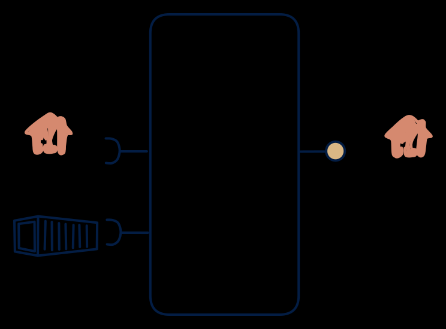

# 2.6 — Upstream facade / proxy API

**Interface:** IN `{B, R}` → OUT `{R}`&emsp;&emsp;**Verdict:** common

Polled from upstream, served as one cleaner API. Value = schema/semantics + caching, not transformation volume (e.g., a tariff API over supplier web services + rate tables). Files and an API in, one clean API out: the normalization facade over a mixed reference source. A diagonal cell in the IN/OUT pattern space — the value is a single canonical, queryable surface over two reference inputs.

## When to use

No transformation-heavy load; the value is integration experience (canonical schema + auth + semantics).

When the value is a unified, canonical API over a batch feed plus a lookup/reference API (a master-data or tariff facade), with no feed and no bulk requirement.

## What's inside

- A **batch loader** for the file leg plus a **poller/connector** (anchor) for the API leg, feeding a **canonical store/cache**.
- A **normalization/merge** layer mapping the two inputs onto the canonical model.
- A **canonical API** (auth, pagination, versioning) as the sole surface.
- State: the canonical store/cache, the API anchor — bounded per key, not a warehouse.

## State & cost

Bounded by the reference's cardinality, not by history or volume: the store holds the latest canonical value per key. No feed, no artifacts. Cheap to run; the cost lives in the upstream's freshness (the anchor) and schema churn (the normalization layer), not in this product's infra.

## Watch out

- The two input legs have different freshness (a file load vs a poll); the canonical API must state the as-of per field, or a consumer will treat a stale polled field as current.
- Caching turns the facade into a stateful product the moment an anchor or a cache entry goes stale; staleness and invalidation policy are part of the contract, not an implementation note.

## Typical next step

Growth is adding surfaces: a file/ETL consumer appears and publication is added — **cell 2.7**; a query-plus-file consumer appears — **2.2**; a change-reactive consumer appears and a synthetic change feed is layered on — **2.4**/**2.5**. A push feed or a second reference input broadens IN toward **row 4**/**row 1**.

## Verdict

**common** — the canonical normalization facade over a mixed reference source — the high-value-per-cost default when the need is one clean API over a batch-plus-API world.

## Related

* [batch](/knowledge-concepts/pattern-batch)
* [request/response](/knowledge-concepts/pattern-request-response)
* [data-product](/knowledge-concepts/data-product) — the overall model
* [verdict](/knowledge-concepts/verdict) — what the common / plausible / niche tag means
