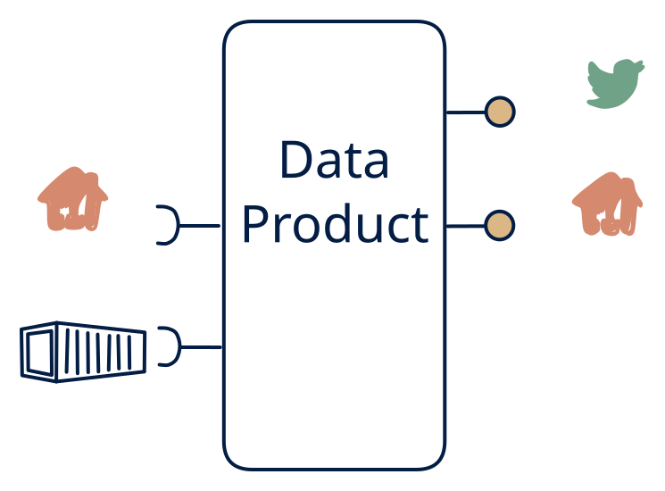

# 2.4 — Poll/file-derived live + query

**Interface:** IN `{B, R}` → OUT `{R, S}`&emsp;&emsp;**Verdict:** niche

Stream + query API built on polled/file inputs. Files and an API in; query and a change feed out, no files out: the "live plus lookup" facade over a reference world. The feed is a synthetic change stream over the refresh; the API is the queryable canonical state.

## When to use

A dashboard wants "live" data but the only source is scheduled polls (device registries, market pages).

When consumers are online and change-reactive over a reference source (they query current state and react to changes), the source is a batch feed plus an API, and no bulk file is required.

## What's inside

- A **batch loader** for the file leg plus a **poller/connector** (anchor) for the API leg, feeding a **canonical store**.
- A **merge/transform** reconciling the two inputs.
- A **change-detection layer** (refresh N vs N-1) driving a **producer** (the synthetic feed) and a **query service** (API).
- State: the canonical store, the anchor, the diff baseline, and the feed log.

## State & cost

Canonical store plus diff baseline plus feed log — the query store and the feed together roughly double the durable footprint versus cell 2.6 alone. The anchor and the diff baseline must be retained for idempotent re-emission after a failure.

## Watch out

Every data point must carry a freshness stamp; polling latency is the truth.

- The feed's "change" is a diff between refreshes: a change that occurs and reverts within one refresh is invisible to feed consumers. That is a semantic gap, not a bug — state it.
- The API and the feed must agree on "now": derive both from the same merge commit, or a consumer seeing a change in the feed but not yet in the API (or vice versa) will attribute the race to the product.

## Synthetic stream

This cell's stream **out** is not backed by a stream **in** — it is a **synthetic stream**: change-detection computed on top of a non-streaming source. The contract must pin down five things (see [synthetic stream](/concepts/synthetic-stream)):

1. **What counts as a "change"** — field-level, row version, or full snapshot?
2. **Latency bound** — bounded by the poll/refresh cadence, not the source's event time.
3. **Idempotency** — re-polling / re-loading must not duplicate events.
4. **Backfill semantics** — how history is (re)issued after a gap or correction.
5. **Ordering** — whether the stream preserves source ordering at all.

## Typical next step

The natural addition is the file surface: a bulk/settlement or archive consumer appears and files are added — **cell 2.1** (full hub) or **2.3** (feed plus file). A push feed replacing the API leg moves the product to **row 4** and retires the diff machinery.

## Verdict

**niche** — a plausible "live plus lookup" reference facade — defensible for online, change-reactive consumers over a batch-plus-API world; the synthetic feed is the cost that keeps it out of the common tier.

## Related

* [batch](/concepts/pattern-batch)
* [request/response](/concepts/pattern-request-response)
* [streaming](/concepts/pattern-streaming)
* [synthetic-stream](/concepts/synthetic-stream) — this cell's stream out is not backed by a stream in
* [data-product](/concepts/data-product) — the overall model
* [verdict](/concepts/verdict) — what the common / plausible / niche tag means
