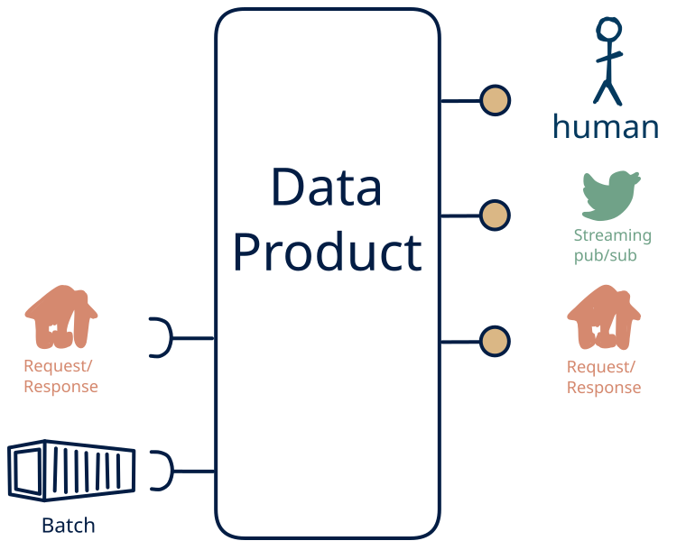

# 2.11 — query + file → API/stream + human

**Interface:** IN {B, R} → OUT {R, S, H}&emsp;&emsp;**Verdict:** common

A product that takes files (batch) and on-demand APIs and serves a query API, a live feed, and a human-facing surface (dashboard/report). Machine-side inputs ({B, R}) drive it — the multi-surface serves people, not just machines.

## When to use

The data the audience wants is real, but the reader is a person, not a service: they need a report or dashboard over a single leg of bulk files and upstream APIs, not raw events or a bulk drop.

## What's inside

- Ingest: a scheduled **bulk ingest** (pickup, parse, validate, load) and a **poller/connector** over the upstream API (version anchor, pagination, retry).
- Core: a **change-detection engine** that manufactures the feed off the non-streaming inputs and a **merge/normalisation core** unifying the non-streaming legs into one canonical view
- Serve: a **query service** (the API surface) over the state store, a **change-detection layer** diffing each refresh, driving a **producer** (a *synthetic* feed), and a **human-facing surface** (dashboard, report, printout, or review screen) — the layer people actually read.
- State: a durable **state store**, a **diff baseline**, and the **feed log** (retention).

## State & cost

Dominated by the durable state store (grows with entity/state breadth) and the diff baseline plus the manufactured feed's log.

## Watch out

- A human-facing surface inherits the state behind it: the report/dashboard carries every as-of and correctness rule of the store, and a person spots a stale number faster than an API client will.
- The **feed is synthetic** (S out, not in): "change" is a computed diff bounded by the refresh cadence — pin what counts as a change, idempotency, and backfill.
- This is machine-produced, human-read: make sure a person actually reviews/approves the served view rather than the pipeline writing it straight through.

## Synthetic stream

This cell serves **S** without taking **S** as input, so its stream is a **synthetic stream**: change-detection computed on top of a non-streaming source. The contract must pin down the five items (see [synthetic stream](/knowledge-concepts/synthetic-stream)):

1. **What counts as a "change"** — field-level, row version, or full snapshot?
2. **Latency bound** — bounded by the refresh cadence, not source event time.
3. **Idempotency** — re-polling / re-loading must not duplicate events.
4. **Backfill semantics** — how history is (re)issued after a gap or correction.
5. **Ordering** — whether the stream preserves source ordering at all.

## Typical next step

add **human curation on the input side** → cell [9.11](/data-product-types/in-bhr-out-rsh) when the data should not be purely machine-fed and add a **bulk file** → cell [2.8](/data-product-types/in-br-out-brsh); or the source world gains a leg this product does not yet take, and it migrates to a richer IN-state on the same row.

## Verdict

**common** — A product that ingests bulk files and query APIs and serves query APIs and live feeds plus a human-facing surface (a dashboard, report, or review). It is the right shape where the reader is a person rather than a service, and the human-shaped view is itself what the next consumer — or the next machine in the loop — needs to act on.

## Related

* [batch](/knowledge-concepts/pattern-batch)
* [request/response](/knowledge-concepts/pattern-request-response)
* [streaming](/knowledge-concepts/pattern-streaming)
* [human](/knowledge-concepts/pattern-human)
* [synthetic stream](/knowledge-concepts/synthetic-stream) — the pseudo-stream hazard
* [data-product](/knowledge-concepts/data-product) — the overall model
* [verdict](/knowledge-concepts/verdict) — what the common / plausible / niche tag means
