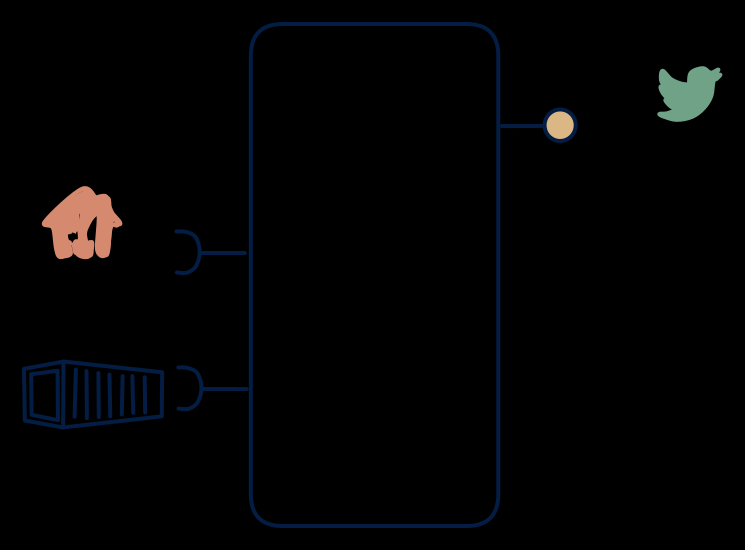

# 2.5 — Poll-to-stream bridge

**Interface:** IN `{B, R}` → OUT `{S}`&emsp;&emsp;**Verdict:** niche

A bridge product whose whole job is "files/APIs → topics". Files and an API in, a change feed out, no query and no files: the purest synthetic-feed bridge of the reference world. The product's whole surface is a manufactured change stream over two reference inputs.

## When to use

A Kafka-first world must consume legacy file/API sources.

When a stream-driven estate must react to changes in a world that is only reachable as a batch feed plus an API — a reference or master-data bridge into a Kafka-first downstream.

## What's inside

- A **batch loader** for the file leg plus a **poller/connector** (anchor) for the API leg, feeding a working store.
- A **diff/change engine** over the working store (field- or row-level change detection between refreshes).
- A **producer** emitting the synthetic change feed — the single surface.
- State: the working store (whole reference), the anchor, the diff baseline, and the feed log.

## State & cost

Light on durable state (whole-reference working store, anchor, baseline) but heavy on contract: replay, ordering, idempotency, and burst behaviour of the manufactured feed are the product's real surface area. The feed log's retention is the main storage line.

## Watch out

Consumers may expect push semantics the source can't honour — document deltas, snapshots, and backfill rules.

- The feed is a burst at refresh time, not a stream: a change-then-revert within a refresh is invisible, a correction re-issues as a spike, and consumers must be safe to re-process a whole reference's delta.
- The two input legs can carry conflicting values for the same key at the same refresh; the diff engine's precedence rule (file vs API) is a data-decision that must be stated, or the feed will carry an arbitrary winner.

## Synthetic stream

This cell's stream **out** is not backed by a stream **in** — it is a **synthetic stream**: change-detection computed on top of a non-streaming source. The contract must pin down five things (see [synthetic stream](/concepts/synthetic-stream)):

1. **What counts as a "change"** — field-level, row version, or full snapshot?
2. **Latency bound** — bounded by the poll/refresh cadence, not the source's event time.
3. **Idempotency** — re-polling / re-loading must not duplicate events.
4. **Backfill semantics** — how history is (re)issued after a gap or correction.
5. **Ordering** — whether the stream preserves source ordering at all.

## Typical next step

Growth is the moment consumers want more than the change feed: a state/query consumer appears and a canonical store plus API is added — **cell 2.6** or **2.4**; an archive/file consumer appears — **2.3**/**2.7**. A push feed or a second reference input broadening IN moves the product toward **row 4**/**row 1**. A source that gains a native change feed (CDC) migrates the product to **row 5** and retires this bridge.

## Verdict

**niche** — a legitimate but high-ops bridge: the top source of "why is my change feed lagging or spiking" in reference-fed estates, chosen deliberately for a stream-first consumer.

## Related

* [batch](/concepts/pattern-batch)
* [request/response](/concepts/pattern-request-response)
* [streaming](/concepts/pattern-streaming)
* [synthetic-stream](/concepts/synthetic-stream) — this cell's stream out is not backed by a stream in
* [data-product](/concepts/data-product) — the overall model
* [verdict](/concepts/verdict) — what the common / plausible / niche tag means
