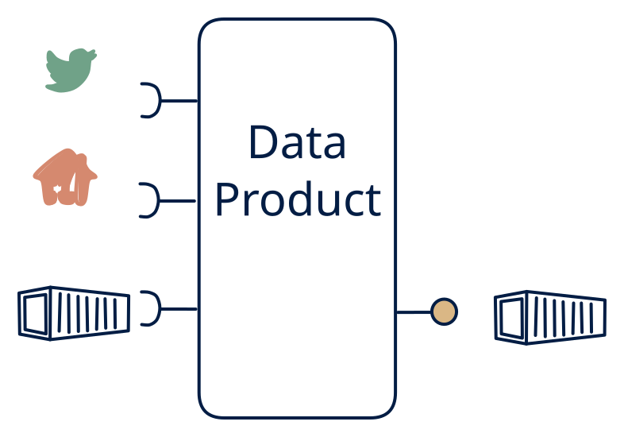

# 1.7 — Multi-source ETL feed

**Interface:** IN `{B, R, S}` → OUT `{B}`&emsp;&emsp;**Verdict:** plausible

Everything in, one file out — the consolidation layer with a single publication surface (settlement or reporting bundle). Everything in, one file out: the consolidation platform with a single surface. The product unifies a live feed, a batch leg, and an API reference into one canonical artifact — the omni-source ETL.

## When to use

The consumer-side contract is file delivery; very common in utility settlement (meter events + tariff APIs + reference files in, one settlement file out).

The contract is a consolidated, authoritative file (a settlement or reporting bundle) but the source world is mixed — live events, batch files, and a lookup API all feed the product.

## What's inside

- A **stream consumer** (offsets) for the live leg, a **batch loader** for the file leg, and a **poller** (anchor) for the API leg, all feeding a **canonical working store**.
- A **merge/reconcile** layer that unifies the three inputs (join on a shared key, apply precedence and time-validity).
- A **publication** that assembles and places the consolidated file with its as-of and manifest.
- State: the canonical working store (one cycle), the live offsets, the API anchor, and the published files.

## State & cost

Bounded working state (one cycle's unification) plus the live offsets, the API anchor, and file retention. No persistent query store or feed — the state cost is the transient unification store and the artifacts. Heavier than a 2.7 or 7.7 (three input legs to keep in step) but far lighter than a 1.1 platform.

## Watch out

Latency expectations collapse to the batch cycle.

- Three input legs mean three time bases (event time, batch cycle, poll as-of): the unification must state the authoritative as-of per field, or the consolidated file will look correct in isolation and wrong when audited against any one source.
- A late event (live leg) arriving after the file has closed is the core correction case: a grace period and a re-issue/correction rule must be explicit, or late data silently drops out of the authoritative file.

## Typical next step

Growth is adding the other surfaces as consumers appear: a query surface for online consumers — **cell 1.2**; a change feed for reactive consumers — **1.3**/**1.5**; the full platform — **1.1**. A steady-state consolidation hub (one file out) often lands here and is a durable, defensible shape.

## Verdict

**plausible** — the canonical omni-source consolidation — the common, defensible answer to "give us one authoritative file over a mixed live-plus-batch-plus-API source."

## Related

* [batch](/concepts/pattern-batch)
* [request/response](/concepts/pattern-request-response)
* [streaming](/concepts/pattern-streaming)
* [data-product](/concepts/data-product) — the overall model
* [verdict](/concepts/verdict) — what the common / plausible / niche tag means
