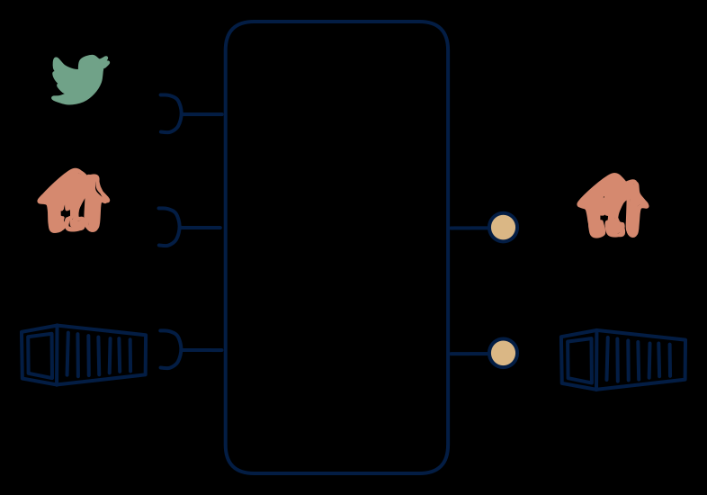

# 1.2 — Consolidation hub with API + reports

**Interface:** IN `{B, R, S}` → OUT `{B, R}`&emsp;&emsp;**Verdict:** common

Everything ingested (files, APIs, streams); consumers get a clean query API plus scheduled files — no streaming out. The most economical "good facade" for pollers and report writers. Everything in; API and files out, no feed: the omni-source hub serving the two quiet surfaces. The product unifies a live feed, a batch leg, and an API reference into one canonical store, exposed as a query and a file.

## When to use

No real-time requirement; the need is just one clean API plus one file feed.

Consumers need both a queryable reference and a bulk file over a mixed source (live events plus batch plus an API reference), and no consumer requires a live change feed.

## What's inside

- A **stream consumer** (offsets), a **batch loader**, and a **poller** (anchor) feeding a **canonical store**.
- A **merge/reconcile** layer unifying the three inputs into the canonical model.
- A **query service** (API) and a **publication job** (file) over the same store.
- State: the canonical store, the live offsets, the API anchor, and the last published file.

## State & cost

The canonical store is the cost centre, refreshed from three input legs — it grows with the breadth of the data, not the volume of changes, but the three-way merge adds per-cycle compute. Plus file artifacts. Heavier than a 1.7 (the query store) and lighter than a 1.1 (no feed-serving stack).

## Watch out

- Three input legs and two output surfaces means six as-of relationships; the store must carry the authoritative as-of per field, or the API and the file will each look correct and disagree with each other on the live leg's data.
- A late event on the live leg landing after the file has published is the core drift case: the API (live) will show it, the file will not, and consumers reconciling the two will see a discrepancy that is actually a timing boundary.

## Typical next step

The natural addition is the feed surface: a change-reactive consumer appears and a change feed over the store is added — **cell 1.1** (full platform). A steady-state hub (no feed) often lands here and stays; adding a feed is the step up to the full platform, dropping the API is the step down to the 1.3/1.5 shape.

## Verdict

**common** — the canonical omni-source hub serving the two quiet surfaces — the common, defensible answer to "give us a clean queryable reference plus a bulk file over a mixed source."

## Related

* [batch](/concepts/pattern-batch)
* [request/response](/concepts/pattern-request-response)
* [streaming](/concepts/pattern-streaming)
* [data-product](/concepts/data-product) — the overall model
* [verdict](/concepts/verdict) — what the common / plausible / niche tag means
