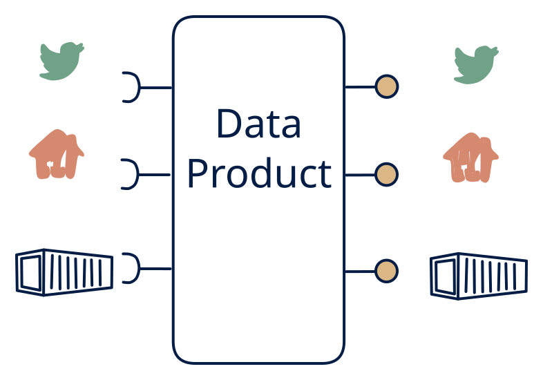

# 1.1 — Data platform / warehouse facade

**Interface:** IN `{B, R, S}` → OUT `{B, R, S}`&emsp;&emsp;**Verdict:** common

Ingests from files, on-demand upstreams, and live streams; serves live events, on-demand queries, *and* bulk files. The full data platform (data lakehouse, CDP). The full platform, in every sense: live, batch, and API in; stream, API, and files out. The omni-source, omni-surface data platform — a data lakehouse or CDP at maximum width.

## When to use

One organisation must serve many consumer types (BI, API clients, settlement, real-time dashboards) from a consolidated view.

When all three consumer families are real over a mixed source (event consumers, query consumers, and file/bulk consumers) and the source itself is mixed (live feed plus batch plus an API).

## What's inside

- A **stream consumer** (offsets), a **batch loader**, and a **poller** (anchor) feeding a **platform store**.
- A **stateful processing/merge core** (windows, joins, reconciliation) that unifies the three inputs.
- A **producer** (stream out), a **query service** (API), and a **publication job** (files) over the same store.
- State: the platform store, the processing state, the feed log, the live offsets, and the artifacts — the widest footprint in the entire space.

## State & cost

The heaviest cell in the entire space: a full platform store plus processing state, feed-log, artifacts, and three input legs to keep in step. Justified only where all three consumer families and all three source families are real — a full CDP/lakehouse — or several surfaces are dead weight.

## Watch out

The most expensive option — the product owns all three serving stacks.

- One merge core feeding three surfaces means one projection or reconciliation bug degrades the stream, the API, and the files simultaneously; independent replay and test paths per output are a requirement, not a nicety.
- Three input legs carry three time bases; the platform must state the authoritative as-of per surface and per field, or each surface will look correct in isolation and wrong when cross-checked.

## Typical next step

This is the top-right corner of the space; there is no pattern to add. Growth is horizontal — more domains, tenants, and history through the same platform — or a simplification where a source leg or a consumer family retires and the product contracts toward a smaller cell. A full platform is a destination, not a starting point.

## Verdict

**common** — the canonical full platform — the expensive, defensible, and common answer when all three consumer families are real over a genuinely mixed source; a data lakehouse or CDP at full width.

## Related

* [batch](/concepts/pattern-batch)
* [request/response](/concepts/pattern-request-response)
* [streaming](/concepts/pattern-streaming)
* [data-product](/concepts/data-product) — the overall model
* [verdict](/concepts/verdict) — what the common / plausible / niche tag means
