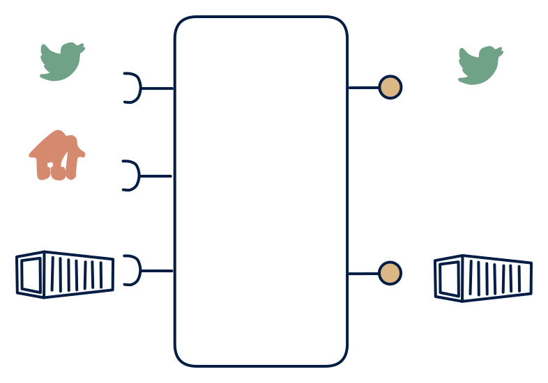

# 1.3 — Hub with live feed + bulk export

**Interface:** IN `{B, R, S}` → OUT `{B, S}`&emsp;&emsp;**Verdict:** common

Consolidated source data exposed as a continuous stream and as bulk archives (e.g., an enterprise event spine with S3 archive). Everything in; stream and files out, no strong query surface: the omni-source event platform with an archive tail. The live feed is the hot surface, the files the cold one, and the three inputs (live, batch, API) feed both.

## When to use

Consumers react to change but also need full loads (historians, downstream stream consumers, reconciliation).

When consumers are stream subscribers plus file/bulk consumers over a mixed source (live events, batch files, and an API reference), and no consumer needs a queryable state.

## What's inside

- A **stream consumer** (offsets), a **batch loader**, and a **poller** (anchor) feeding an **event/working store**.
- A **merge/enrich core** unifying the three inputs into the event stream and the archive.
- A **producer** (stream out) and a **publication job** (file/archive out).
- State: the event store, the live offsets, the API anchor, the feed log, and the archive storage.

## State & cost

The feed log plus archive retention dominate, with the event/working store and the API anchor smaller. Heavier than a 1.5 (the archive, the batch and API legs) and lighter than a 1.1 (no query store). The dual-retention (feed plus archive) is the standing cost line.

## Watch out

- Three input legs into a single event stream means the feed's ordering and the files' as-of are both decisions: a consumer who relies on the live leg's event time for the archive's truth will be wrong where the batch or API leg contributes.
- A late event (live leg) arriving after an archive window has closed is the core reconciliation case; a grace period and a correction rule must be explicit, or late data appears in the stream but not in the archive.

## Typical next step

The natural addition is the query surface: a state consumer appears and a canonical store plus API is added — **cell 1.2** (hub) or the full **1.1**. A steady-state event platform (stream plus archive) often lands here and stays; adding a query is the step up.

## Verdict

**common** — the canonical omni-source event platform — the common, defensible answer to "give us a clean live feed plus an archive over a mixed source," with the query surface explicitly out of scope.

## Related

* [batch](/knowledge-concepts/pattern-batch)
* [request/response](/knowledge-concepts/pattern-request-response)
* [streaming](/knowledge-concepts/pattern-streaming)
* [data-product](/knowledge-concepts/data-product) — the overall model
* [verdict](/knowledge-concepts/verdict) — what the common / plausible / niche tag means
