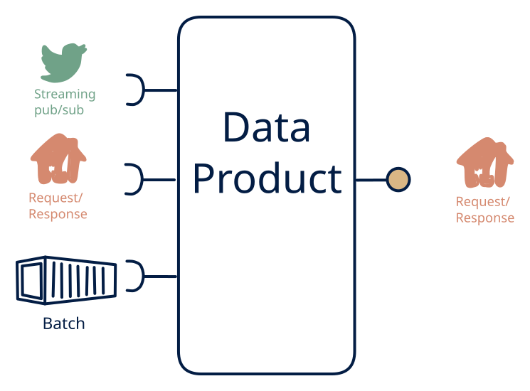

# 1.6 — Unified query API over messy sources

**Interface:** IN `{B, R, S}` → OUT `{R}`&emsp;&emsp;**Verdict:** common

The BFF / service façade: files + upstream APIs + event feeds behind one request/response contract. Everything in, one clean API out: the BFF / service facade over a mixed source. The product unifies a live feed, a batch leg, and an API reference behind one canonical request/response contract.

## When to use

The product's value is *normalisation*: consumers want one schema and one endpoint (unified "customer" or "order" API over CRM/ERP/events).

The value is normalisation: a unified, canonical API (a "customer", "order", or "asset" view) over a CRM/ERP/file/stream mess — no feed and no bulk requirement.

## What's inside

- A **stream consumer** (offsets), a **batch loader**, and a **poller** (anchor) feeding a **canonical store/cache**.
- A **normalization/merge** layer unifying the three inputs onto the canonical model.
- A **canonical API** (auth, pagination, versioning) as the sole surface.
- State: the canonical store/cache, the live offsets, the API anchor — bounded per key, not a full platform store.

## State & cost

Bounded by the data's cardinality per key, not by history or volume: the store holds the latest canonical value (a facade) or a bounded working set, plus the live offsets and the API anchor. No feed, no artifacts. Moderate — a facade over three inputs costs more in merge complexity than in storage.

## Watch out

- Three input legs behind one facade means three as-of sources for the same canonical key; the API must state the as-of per field, or a consumer will read a stale polled field as current next to a fresh live one.
- The facade's value is the canonical contract: an upstream schema or stream change propagates through the normalization layer silently, and a consumer pinned to the old contract breaks without a loud failure.

## Typical next step

Growth is adding the other surfaces as consumers appear: bulk/file consumers — **cell 1.2**; change-reactive consumers and a feed — **1.4**/**1.5**; the full platform — **1.1**. A steady-state facade (one API out) is a durable, defensible shape and a common default for "unify this mess behind one API."

## Verdict

**common** — the canonical BFF/service facade over a mixed source — the high-value-per-cost default when the need is one clean, canonical API unifying live, batch, and reference inputs.

## Related

* [batch](/knowledge-concepts/pattern-batch)
* [request/response](/knowledge-concepts/pattern-request-response)
* [streaming](/knowledge-concepts/pattern-streaming)
* [data-product](/knowledge-concepts/data-product) — the overall model
* [verdict](/knowledge-concepts/verdict) — what the common / plausible / niche tag means
* [architectural paradigms](/knowledge-concepts/architectural-paradigms) — this cell maps to: Backend-for-Frontend / API gateway: many inputs normalised into one clean request/response API.
