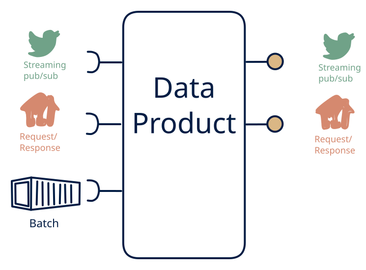

# 1.4 — Unified real-time view

**Interface:** IN `{B, R, S}` → OUT `{R, S}`&emsp;&emsp;**Verdict:** common

Consumers query current state *and* subscribe to changes; no bulk files served. Historical depth is served by query, not by file. Everything in; query and a live feed out, no files: the unified real-time platform. The product serves the two online surfaces — a queryable current state and the stream of changes — over a mixed source, with deep history handled by query rather than file.

## When to use

All consumers are online (e.g., an IoT/time-series platform with event + state APIs).

All consumers are online (they query current state and/or subscribe to change) over a mixed source (live events, batch, and an API reference), and long-term bulk is either a separate warehouse's job or out of scope.

## What's inside

- A **stream consumer** (offsets), a **batch loader**, and a **poller** (anchor) feeding a **state store**.
- A **projection/merge** unifying the three inputs into a single source of truth for both surfaces.
- A **query service** (R) and a **producer** for the change/live feed (S).
- State: the state store, the change feed log, the live offsets, and the API anchor — no artifacts.

## State & cost

The state store plus feed-log retention dominate, with the live offsets and API anchor smaller. Heavier than a 1.6 (the feed log) and lighter than a 1.1 (no artifacts). The "no files" cut means the state store and the feed log are the only recovery paths, and both must be retained on purpose.

## Watch out

Long-term archive may still need an off-product cold tier to keep storage sane.

- The feed is derived from the unified state, not a raw pass-through of any one input: a consumer who expects a particular input's ordering or granularity will find the feed re-keyed and re-sequenced by the merge.
- Long-term history is served by query, not file: if a consumer needs an export or a reconciliation artifact, it is out of contract, and the state store's retention policy is the only durability anchor.

## Typical next step

The natural addition is the file surface: a bulk, settlement, or reconciliation consumer appears and files are added — **cell 1.1** (full platform) or **1.3** (feed plus files). A steady-state real-time platform (query plus feed, no files) is a clean, defensible destination when bulk is genuinely out of scope.

## Verdict

**common** — the canonical unified real-time platform — the common, defensible answer to "give us current state plus a live view of change over a mixed source," with files explicitly out of scope.

## Related

* [batch](/knowledge-concepts/pattern-batch)
* [request/response](/knowledge-concepts/pattern-request-response)
* [streaming](/knowledge-concepts/pattern-streaming)
* [data-product](/knowledge-concepts/data-product) — the overall model
* [verdict](/knowledge-concepts/verdict) — what the common / plausible / niche tag means
