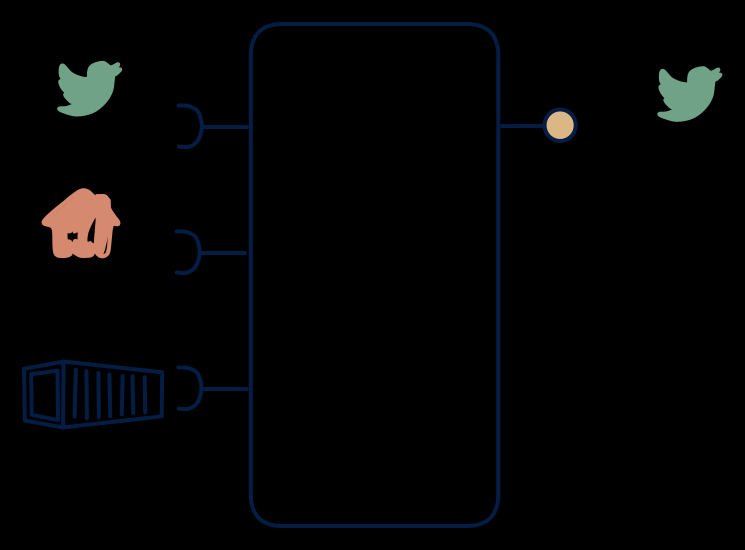

# 1.5 — All-in, single stream

**Interface:** IN `{B, R, S}` → OUT `{S}`&emsp;&emsp;**Verdict:** niche

"One topic for the world": all sources (files included, replayed as events) funneled into one pub/sub interface. Everything in, one stream out: the omni-source fan-out. The product unifies a live feed, a batch leg, and an API reference into a single published stream — a "one topic for the world" over the widest possible source mix.

## When to use

Downstream is a pure stream topology (Kafka mesh, CEP fabric).

When downstream is stream-first (one clean topic, one ordering) and the source world is maximally mixed (live events, batch files, and a lookup/reference API) — a canonical event publication.

## What's inside

- A **stream consumer** (offsets), a **batch loader**, and a **poller** (anchor) feeding a **publication store**.
- A **merge/unification core** that reconciles the three inputs into one ordered event stream (the hardest part, given three time bases).
- A **producer** emitting the single unified stream — the sole surface.
- State: the publication store, the live offsets, the API anchor, and the output feed log.

## State & cost

Moderate to heavy: the output feed log's retention dominates, with the publication store and the input legs' anchors and offsets smaller. There is no query store or artifact tier — the cost is in keeping three input legs in step and in the unified stream's retention.

## Watch out

File-based sources become synthetic streams — backfill is loud.

- Three input legs with three time bases behind one unified stream is the core difficulty: the publication must define the authoritative ordering and as-of across legs, or the single "clean topic" is actually three interleaved truths.
- The batch and API legs are not live: their changes appear in the unified stream at refresh time, interleaved with the live leg's events. A consumer who assumes uniform latency across the stream's fields will mis-attribute staleness.

## Typical next step

Growth is adding the other surfaces as consumers appear: a query surface — **cell 1.4** (real-time view) or **1.2** (hub); a file/archive surface — **1.3**; the full platform — **1.1**. If the live leg is dropped (a batch-plus-API source only), the product contracts toward **row 2** with a feed (the 2.1/2.5 shape).

## Verdict

**niche** — the canonical omni-source fan-out — a defensible, if unusual, answer to "give me one clean, authoritative stream over a maximally mixed source"; the unification across three time bases is what makes it a deliberate choice.

## Related

* [batch](/concepts/pattern-batch)
* [request/response](/concepts/pattern-request-response)
* [streaming](/concepts/pattern-streaming)
* [data-product](/concepts/data-product) — the overall model
* [verdict](/concepts/verdict) — what the common / plausible / niche tag means
