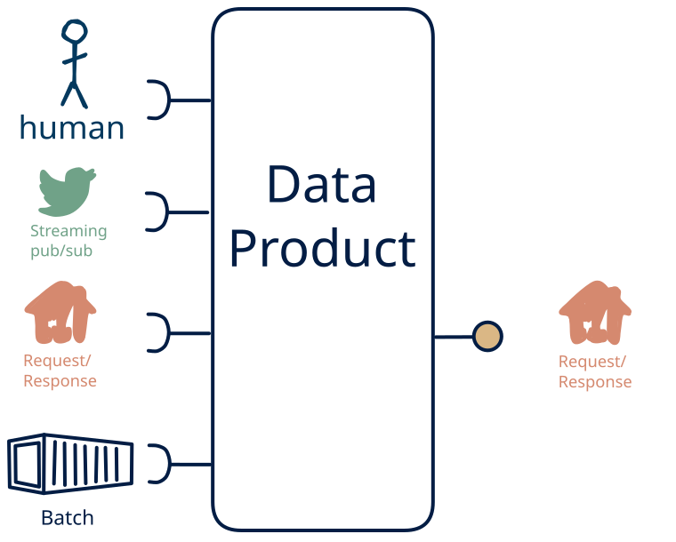

# 8.6 — omni-channel + human → request-response-only

**Interface:** IN {B, R, S, H} → OUT {R}&emsp;&emsp;**Verdict:** plausible

A product that takes files (batch), on-demand APIs, live streams, and human-produced data and serves a query API. Human-entered data is one leg of the source, alongside files, upstream APIs, and live streams; the product carries that mix through to a query API.

## When to use

The data is partly human-curated, alongside files, upstream APIs, and live streams, and the audience needs it as a query API — the product is the layer between a person's editing and the consumer.

## What's inside

- Ingest: a scheduled **bulk ingest** (pickup, parse, validate, load), a **poller/connector** over the upstream API (version anchor, pagination, retry), a **stream consumer** (offsets, replay) for the live leg, and **human entry / curation** — data produced by people (forms, editors, review UIs), validated and audit-trailed on every change.
- Core: a **fold/aggregation core** that folds the live leg into queryable state or windowed files and a **merge layer** that unifies human-entered data with the machine legs into one canonical view
- Serve: a **query service** (the API surface) over the state store.
- State: a durable **state store**, the **feed log** (retention), and an **audit trail** of human changes.

## State & cost

Dominated by the durable state store (grows with entity/state breadth) and the audit trail of human edits.

## Watch out

- Human-entered data is the softest input: it arrives irregularly, carries intent and errors, and needs **validation, provenance, and a correction path** — trust leans on the audit trail, not the schedule.
- **Mixed time bases** in the inputs (live vs. poll/cycle/human): fix the authoritative as-of per surface, or each output looks correct alone and wrong cross-checked.
- Late and out-of-order events are a **first-class** question: a watermark and a re-issue/correction rule, or history gains holes and duplicate facts.

## Typical next step

add a **human-facing surface** → cell [8.13](/data-product-types/in-brsh-out-rh), add a **bulk file** → cell [8.2](/data-product-types/in-brsh-out-br), and add a **feed** → cell [8.4](/data-product-types/in-brsh-out-rs); or the source world gains a leg this product does not yet take, and it migrates to a richer IN-state on the same row.

## Verdict

**plausible** — turning human-entered data into a downstream surface is sensible but project-shaped — a curation product, not a default pipe, and its demand is real where this audience exists.

## Related

* [batch](/knowledge-concepts/pattern-batch)
* [request/response](/knowledge-concepts/pattern-request-response)
* [streaming](/knowledge-concepts/pattern-streaming)
* [human](/knowledge-concepts/pattern-human)
* [data-product](/knowledge-concepts/data-product) — the overall model
* [verdict](/knowledge-concepts/verdict) — what the common / plausible / niche tag means
