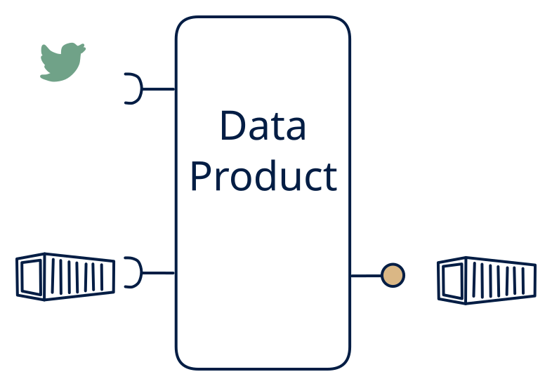

# 3.7 — Stream → settlement files

**Interface:** IN `{B, S}` → OUT `{B}`&emsp;&emsp;**Verdict:** common

Real-time metered events + reference data in → daily settlement file out. The heart of many utility settlement engines. Real-time events plus batch reference in, a settlement file out: the settlement engine of the utility/energy world. The product's identity is a settlement window fed by a live meter stream and a batch tariff.

## When to use

The market contract is file-based (day-ahead / imbalance settlement) but the data is inherently streaming.

The contract is a settlement file (day-ahead, imbalance, metered settlement) over inherently live metered data plus a batch tariff/master reference.

## What's inside

- A **stream consumer** (offsets) for the live metered events, plus a **batch loader** for the tariff/master reference.
- A **windowed settlement engine** (interval windows) that joins the live events to the reference and accumulates per settlement cycle.
- A **publication** step that closes the window and emits the settlement file with its as-of and a correction/supersession rule.
- State: the open settlement window accumulators, the loaded reference, and the published files (with correction history).

## State & cost

Bounded working state (the open window) plus reference and file retention. The live side is cheap (a stream); the durable cost is the settlement files and the reference tables. The window accumulators are the only genuinely stateful piece, and they are bounded by the settlement cycle.

## Watch out

- Late metered events are the core risk: a grace period and a correction mechanism (re-open, re-issue, or a correction file) must be explicit, or late data silently drops out of the settlement.
- The reference join is a decision, not a computation: which tariff version applies to which interval, and whether a mid-window tariff change applies, must be stated per settlement rule.

## Typical next step

Natural growths: a query consumer appears and a read model/API over the settlement state is added — **cell 3.6**; a live feed consumer appears and the meter stream is re-exposed — **3.5**/**3.4**; a live reference (API) replaces the batch tariff and the product moves to **row 4** (the 4.7 shape). Dropping the stream leg (reference-only) contracts toward **row 1**.

## Verdict

**common** — the heart of utility/energy settlement — the most load-bearing cell in a metered, regulated domain, and a common, defensible shape wherever live meter data must settle to a file.

## Related

* [batch](/concepts/pattern-batch)
* [streaming](/concepts/pattern-streaming)
* [data-product](/concepts/data-product) — the overall model
* [verdict](/concepts/verdict) — what the common / plausible / niche tag means
