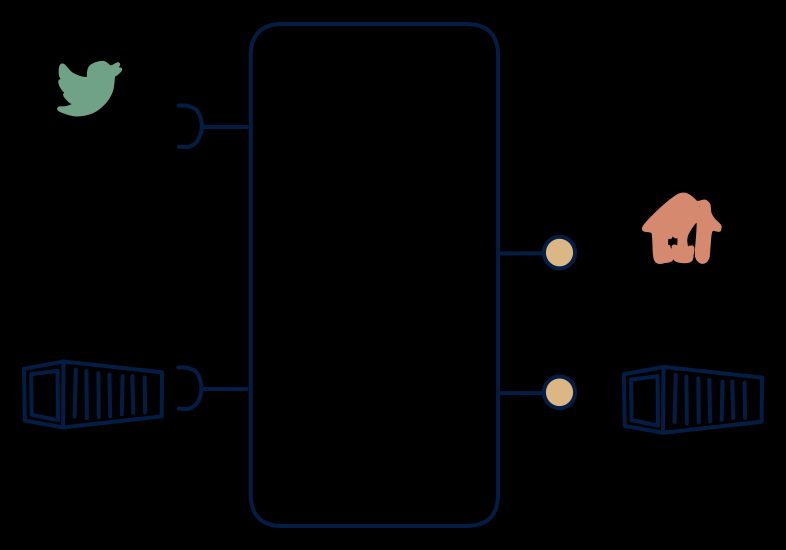

# 3.2 — Smart-meter platform shape

**Interface:** IN `{B, S}` → OUT `{B, R}`&emsp;&emsp;**Verdict:** common

Live meter events + tariff reference (batch) in → reading API + settlement files out. The common utility shape; consumers pull, no pure stream out.

## When to use

Utility/energy domain: metered streams plus reference files, served to both online and bulk consumers.

## Related

* [batch](/knowledge-concepts/pattern-batch)
* [request/response](/knowledge-concepts/pattern-request-response)
* [streaming](/knowledge-concepts/pattern-streaming)
* [data-product](/knowledge-concepts/data-product) — the overall model
* [verdict](/knowledge-concepts/verdict) — what the common / plausible / niche tag means

