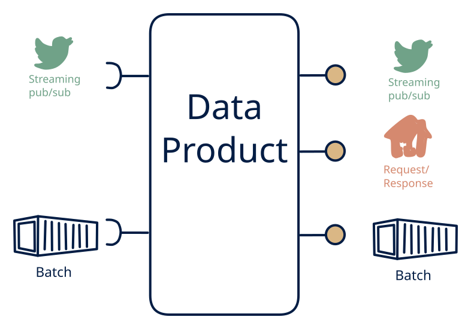

# 3.1 — Event platform with full serving

**Interface:** IN `{B, S}` → OUT `{B, R, S}`&emsp;&emsp;**Verdict:** common

Hot & cold ingest (e.g., Kafka + S3) served via streams, APIs, and bulk exports — the modern streaming platform (Kafka + Iceberg/Delta). The full streaming platform over a hot-and-cold source: meter/stream plus batch in; stream, API, and files out. The modern streaming platform (Kafka plus Iceberg/Delta) at maximum width.

## When to use

All three consumer types are needed on top of event data.

When all three consumer families are real over a metered/streaming world with a batch leg — a full IoT/telemetry platform that must serve event consumers, query consumers, and file consumers at once.

## What's inside

- A **stream consumer** (offsets) for the live leg plus a **batch loader** for the cold leg, feeding a **platform store** (Iceberg/Delta-style).
- A **stateful processing core** (windows, joins) that feeds all three surfaces.
- A **producer** (stream out), a **query service** (API), and a **publication job** (files) over the same store.
- State: the platform store, the processing state, the feed log, the offsets, and the artifacts — the widest footprint of row 3.

## State & cost

Heaviest cell of row 3: a full platform store plus processing state, feed-log, and artifacts, all maintained from two input legs. Justified only where all three consumer families are real — a full platform — or several surfaces are wasted infrastructure.

## Watch out

- The hot and cold legs join on different time bases (event time vs batch cycle); the platform must state which timestamp is authoritative per surface, or the stream, the API, and the files will each look correct in isolation and wrong together.
- Three surfaces over one store means one projection bug degrades all three at once; the processing core needs independent replay and test paths for each output.

## Typical next step

At this corner the pattern space is exhausted; growth is horizontal (device base, tenants, history) or an input-side maturation (a live reference, a new event source) that widens the platform. The common contraction is dropping the heaviest surface — usually the feed or the files — yielding **3.2** or **3.3**.

## Verdict

**common** — the canonical full streaming platform — the expensive, defensible answer when all three consumer families are real over a metered/streaming world.

## Related

* [batch](/concepts/pattern-batch)
* [request/response](/concepts/pattern-request-response)
* [streaming](/concepts/pattern-streaming)
* [data-product](/concepts/data-product) — the overall model
* [verdict](/concepts/verdict) — what the common / plausible / niche tag means
