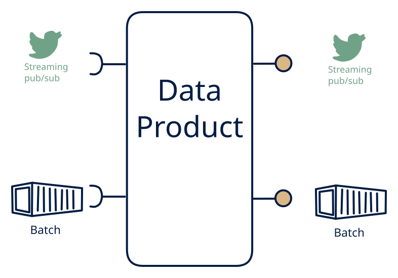

# 3.3 — Hot & cold in → hot & cold out

**Interface:** IN `{B, S}` → OUT `{B, S}`&emsp;&emsp;**Verdict:** common

Pass-through streaming platform: events stay events; bulk in merges in or becomes bulk out (e.g., Kafka mirror + S3 archive service). Hot-and-cold in, hot-and-cold out: the pass-through streaming platform. Events plus batch in; a stream and files out — the product routes, mirrors, and archives rather than transforming semantics. A diagonal cell in pattern space.

## When to use

Consumers subscribe to feeds *and* consume archives; goal is a single consistent pipeline.

When the value is a clean, durable, well-formed feed plus an archive — a market-event mirror, a Kafka mirror plus S3 archive — and there is no state, query, or heavy computation to do.

## What's inside

- A **stream consumer** (offsets) for the live leg plus a **batch loader** for the cold leg.
- A **routing/mirroring core** (filter, repartition, format-map, preserve) — deliberately light on state.
- A **producer** (stream out) and a **publication/sink** (file/archive out).
- State: offsets, feed-log retention, and archive storage. Little or no durable keyed state.

## State & cost

Light on state (a mostly stateless mirror) but heavy on throughput plus dual-retention (feed log and archive both accrue). The archive is the durable cost line. Cheaper than a 3.2/3.3 platform (no keyed store or settlement state), pricier than a pure 5.5 relay (the batch leg plus the archive).

## Watch out

- A mirror is only as trustworthy as its partitioning and ordering: consumers who rely on the source's partition key and order will break if the mirror repartitions or reorders, even though the data is unchanged.
- The archive and the stream must be reconcilable: a consumer who reads the archive must be able to map it back to the stream's offsets, or the "same data, two forms" promise quietly fails.

## Typical next step

Growth appears when state is needed: a settlement or "current state" consumer appears and the product gains a keyed store — it becomes **cell 3.4**/**3.6** (state) or **3.2** (a platform). A live reference (API) joining IN broadens the product into **row 4** (the 4.3/4.4 shapes). Dropping the batch leg contracts toward **row 5**.

## Verdict

**common** — the canonical pass-through/archive platform — a common, low-state shape where the value is a clean, durable, well-formed feed plus an archive, not computation.

## Related

* [batch](/concepts/pattern-batch)
* [streaming](/concepts/pattern-streaming)
* [data-product](/concepts/data-product) — the overall model
* [verdict](/concepts/verdict) — what the common / plausible / niche tag means
* [architectural paradigms](/concepts/architectural-paradigms) — this cell maps to: Event-driven architecture (EDA): stream + batch in, stream + batch out — a pass-through platform.
