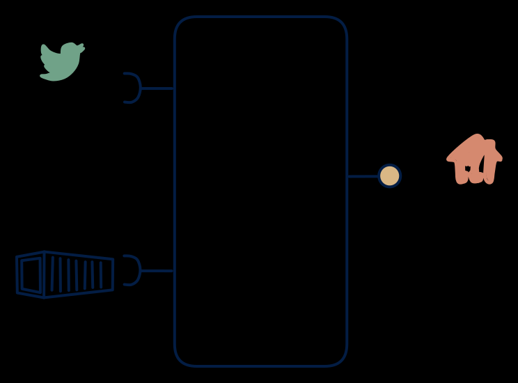

# 3.6 — Stream + reference → queryable historian

**Interface:** IN `{B, S}` → OUT `{R}`&emsp;&emsp;**Verdict:** common

The historian pattern: events land in a time-series/state DB, reference data is periodically loaded, consumers query (e.g., SCADA historian + historian API). The historian pattern: live metered events plus batch reference in, a queryable historian out. The product is a time-series/state store built for "what happened" queries, with no feed or file surface.

## When to use

Consumers want analysis over history, not push.

When consumers want analysis and reconstruction over history — a SCADA historian, a metering historian, an event-sourced analytics store — and the source is a live stream plus a batch reference.

## What's inside

- A **stream consumer** (offsets) plus a **batch loader** for the reference.
- A **time-series/state store** (the historian) with per-key sequencing for late and out-of-order events.
- A **query service** over the historian (the sole surface) with the as-of and correction model.
- State: the historian store (grows with history), the loaded reference, and the offsets.

## State & cost

The historian store is the cost centre: it grows monotonically with event volume and retention, far faster than a fold-based read model (it appends rather than upserts). The reference is small. No feed, no artifacts — the cost is storage and query throughput over growing history.

## Watch out

- Late and out-of-order events are the core correctness problem in a historian: a per-key sequence and a watermark (or correction marker) are required, or history will contain holes or duplicated facts that query consumers will surface.
- Corrections are a first-class query concern, not an ingest detail: a consumer reconstructing "the value at T" must be able to see whether T was later corrected, and the model must say so.

## Typical next step

Growth is adding surfaces: a settlement consumer appears and files are added — **cell 3.7** (settlement) or **3.2** (platform); a live feed consumer appears and the stream is re-exposed — **3.4**/**3.5**; a live reference (API) joins IN and the product moves to **row 4** (the 4.6 shape). A historian often matures into the 3.2/3.7 platform.

## Verdict

**common** — the canonical historian — the common, defensible answer to "we need queryable, reconstructable history over a live metered stream plus a batch reference".

## Related

* [batch](/concepts/pattern-batch)
* [request/response](/concepts/pattern-request-response)
* [streaming](/concepts/pattern-streaming)
* [data-product](/concepts/data-product) — the overall model
* [verdict](/concepts/verdict) — what the common / plausible / niche tag means
