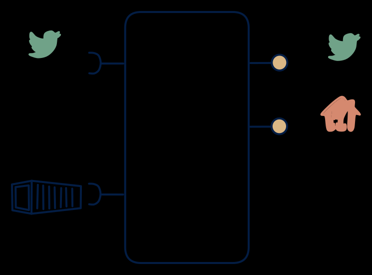

# 3.4 — Event + state query, no files

**Interface:** IN `{B, S}` → OUT `{R, S}`&emsp;&emsp;**Verdict:** niche

Live events and on-demand state queries; no bulk serving. Live events plus batch reference in; query and feed out, no files. The online version of the historian with a live facet — a "current state plus stream of changes" over a metered world, deliberately without bulk.

## When to use

Consumers are online and bulk export is a different product's job.

When consumers are online (they query current state and/or subscribe to change) over a metered/live-plus-batch world, and long-term bulk is handled by a separate warehouse or is out of scope.

## What's inside

- A **stream consumer** (offsets) plus a **batch loader** for the reference, feeding a **state store**.
- A **projection/fold** producing the queryable state and the change events (one source of truth for R and S).
- A **query service** (R) and a **producer** for the change feed (S).
- State: the state store, the change feed log, the loaded reference, and the offsets.

## State & cost

The state store plus feed-log retention dominate, with a small reference table. Heavier than a 3.6 (the feed log) and lighter than a 3.1/3.2 (no artifacts). The "no files" cut means the feed log and the store are the only recovery paths, and both must be retained on purpose.

## Watch out

Long-term retention usually still wants a cold/file tier — verify history isn't just being dropped.

- The change feed is derived from the state, not a raw pass-through of the meter stream: consumers who expect the input's ordering, granularity, or idempotency will find the output feed re-keyed and re-sequenced.
- Late metered data re-writes both the queryable state and the change feed; without a correction semantics consumers will see a "change event" that is really a correction and mis-model it.

## Typical next step

The natural addition is the file surface: bulk/settlement or reconciliation consumers appear and files are added — **cell 3.7** (settlement) or **3.2** (platform). A live reference (API) replacing the batch leg broadens IN toward **row 4** (the 4.4 shape). Dropping the feed contracts toward **3.6**.

## Verdict

**niche** — a clean, defensible online metering platform — the common answer when query and feed consumers live online and files are explicitly out of scope.

## Related

* [batch](/knowledge-concepts/pattern-batch)
* [request/response](/knowledge-concepts/pattern-request-response)
* [streaming](/knowledge-concepts/pattern-streaming)
* [data-product](/knowledge-concepts/data-product) — the overall model
* [verdict](/knowledge-concepts/verdict) — what the common / plausible / niche tag means
