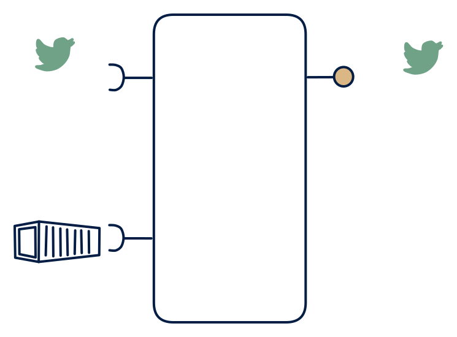

# 3.5 — Stream join / stream enrichment

**Interface:** IN `{B, S}` → OUT `{S}`&emsp;&emsp;**Verdict:** plausible

Enriches an event stream with bulk-loaded reference data and emits an enriched stream (e.g., meter events + tariff/reference → enriched market events). A stream join / enrichment: metered events plus batch reference (tariff, master) in, an enriched stream out. The product is the join — the value is an enriched, ready-to-consume event, not a state.

## When to use

The product's value is enrichment; consumers are stream consumers.

When the need is context: enrich raw metered/device events with a batch-loaded tariff or master reference and emit a single enriched stream for downstream consumers.

## What's inside

- A **stream consumer** (offsets) for the events plus a **batch loader** materialising the reference as a **dimension table**.
- A **join/enrich core** (a lookup join on the event key, often with a time-validity condition against the dimension).
- A **producer** emitting the enriched stream — the single surface.
- State: the dimension table (bounded by the reference's size), the join's in-flight state, and the consumer offsets.

## State & cost

Light on state: a dimension table bounded by the reference's cardinality, a bounded in-flight join state, and offsets. No store of output, no feed of its own beyond the platform's. The enrichment is cheap; the cost is the reference's freshness and the join's correctness.

## Watch out

- Dimension staleness is the core risk: an event that arrives after the tariff changed may be enriched with the wrong version if the time-validity join is not keyed by event time, and the error is silent.
- A late reference update (a tariff restatement) is not retroactively reapplied to already-emitted enriched events unless a re-emit/correction path exists; state which events are covered by the update.

## Typical next step

Growth is the moment consumers want more than the enriched stream: a state consumer appears and a read model/API is added — **cell 3.6**; a settlement consumer appears and the enrichment feeds a windowed file — **3.7**/**3.2**; a live reference (API) replaces the batch dimension and the product moves to **row 4** (the 4.3/4.5 shapes). A pure 5.5 relay is the stateless core of this cell.

## Verdict

**plausible** — the canonical stream-join/enrichment cell — a common, low-state shape where the value is context added to a raw stream, not state held for it.

## Related

* [batch](/concepts/pattern-batch)
* [streaming](/concepts/pattern-streaming)
* [data-product](/concepts/data-product) — the overall model
* [verdict](/concepts/verdict) — what the common / plausible / niche tag means
