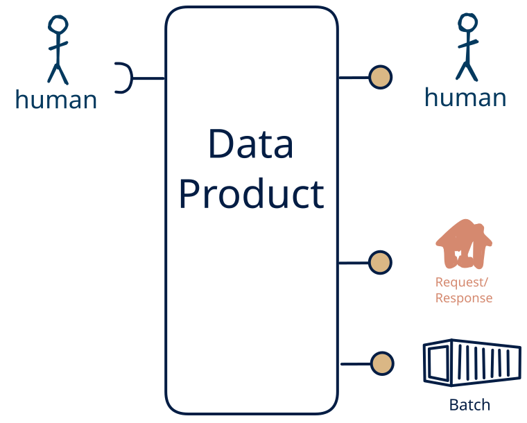

# 15.9 — human-only → file/API + human

**Interface:** IN {H} → OUT {B, R, H}&emsp;&emsp;**Verdict:** common

A product that takes human-produced data and serves bulk files, a query API, and a human-facing surface (dashboard/report). People both produce and read the data: the human pattern is on both sides.

## When to use

A small group of people both maintains and reads the data, with no machine consumer — a shared, human-scale record rather than an automated interface.

## What's inside

- Ingest: **human entry / curation** — data produced by people (forms, editors, review UIs), validated and audit-trailed on every change.
- Core: a light transform between ingest and serve
- Serve: a **publication job** that materialises bulk artifacts (files/bundles) with a manifest and as-of, a **query service** (the API surface) over the state store, and a **human-facing surface** (dashboard, report, printout, or review screen) — the layer people actually read.
- State: a durable **state store**, the **retained bulk artifacts**, and an **audit trail** of human changes.

## State & cost

Dominated by the durable state store (grows with entity/state breadth), the retained bulk artifacts, and the audit trail of human edits. The cost is not infrastructure but discipline: human-entered data needs validation, provenance, and a correction path.

## Watch out

- **Softness is a cost, not a value judgement.** Human-entered data is the softest input — irregular, subjective, error-prone, expensive to re-issue — so it needs **validation, provenance, and a correction path**, and trust leans on the audit trail, not the schedule. It is also the most expensive channel: where a machine source *can* carry the same meaning, prefer it, and keep the human leg for what only a person can supply.
- **Human input can be the value-driver.** Where the human act *is* the value — a judgement, a design intent, creative or social content, an accountable decision — and cannot be automated, human input is the **most valuable input** the product has, and the other legs exist to *enrich* it (see [the role of human input](/concepts/role-of-human-input)).
- A human-facing surface inherits the state behind it: the report/dashboard carries every as-of and correctness rule of the store, and a person spots a stale number faster than an API client will.

## Typical next step

add a **feed** → cell [15.8](/data-product-types/in-h-out-brsh) (synthetic only if the human change is observed state rather than delivered actions — see [synthetic stream](/concepts/synthetic-stream)); or the source world gains a leg this product does not yet take, and it migrates to a richer IN-state on the same row.

## Verdict

**common** — A product that ingests human-authored data and serves bulk files and query APIs plus a human-facing surface (a dashboard, report, or review). It is a natural fit where the human act *is* the value — a judgement, a decision, a curated record — so the softest, costliest channel is then the *cost of having that value*; where the act *could* be automated the cheaper machine path wins.

## Related

* [batch](/concepts/pattern-batch)
* [request/response](/concepts/pattern-request-response)
* [human](/concepts/pattern-human)
* [data-product](/concepts/data-product) — the overall model
* [verdict](/concepts/verdict) — what the common / plausible / niche tag means
