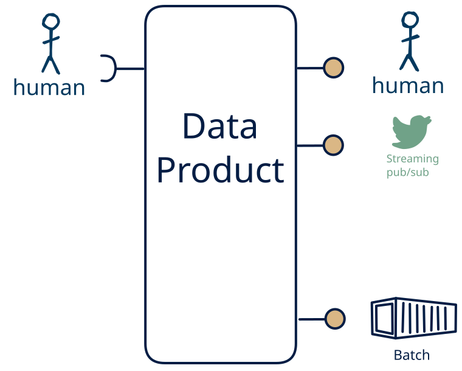

# 15.10 — human-only → file/stream + human

**Interface:** IN {H} → OUT {B, S, H}&emsp;&emsp;**Verdict:** common

A product that takes human-produced data and serves bulk files, a live feed, and a human-facing surface (dashboard/report). People both produce and read the data: the human pattern is on both sides.

## When to use

A small group of people both maintains and reads the data, with no machine consumer — a shared, human-scale record rather than an automated interface.

## What's inside

- Ingest: **human entry / curation** — data produced by people (forms, editors, review UIs), validated and audit-trailed on every change.
- Core: a **stream core** that turns each change into an event — **trigger-based**, where each human action delivered through this product's own surface (form submission, approval, entry) is itself a discrete event, or **observed-state**, where a **change-detection engine** manufactures the events by diffing the non-streaming inputs on a refresh cadence
- Serve: a **publication job** that materialises bulk artifacts (files/bundles) with a manifest and as-of, a **producer** that emits the event feed to subscribers, and a **human-facing surface** (dashboard, report, printout, or review screen) — the layer people actually read.
- State: a durable **state store**, the **retained bulk artifacts**, the **event log** (retention), an **audit trail** of human changes, and — in the observed-state shape — a **diff baseline**.

## State & cost

Dominated by the durable state store (grows with entity/state breadth), the retained bulk artifacts, the event log, and the audit trail of human edits (plus a diff baseline in the observed-state shape). The cost is not infrastructure but discipline: human-entered data needs validation, provenance, and a correction path.

## Watch out

- Human-entered data is the softest input: it arrives irregularly, carries intent and errors, and needs **validation, provenance, and a correction path** — trust leans on the audit trail, not the schedule.
- A human-facing surface inherits the state behind it: the report/dashboard carries every as-of and correctness rule of the store, and a person spots a stale number faster than an API client will.
- **Where the feed is synthetic, and where it is not:** when human actions are delivered through this product's own surface (a submission, an approval, an entry), each action is a discrete, real event and the feed is *not* synthetic. When changes arrive as *modified state* (edited elsewhere, found by refresh), the feed is a **synthetic stream** — "change" is a computed diff bounded by the refresh cadence — and the contract must pin what counts as a change, idempotency, and backfill (see [synthetic stream](/knowledge-concepts/synthetic-stream)).

## The stream: trigger-based or synthetic

This cell serves **S** without taking **S** as input, and it hosts two shapes — only one of which is synthetic:

- **Trigger-based** — a real event stream: the human action itself (a submission, an approval, an entry through this product's own surface) is the discrete event, with its occurrence time. S is absent from the IN side because a person produced the data, not because the events are being manufactured.
- **Observed-state** — a **synthetic stream**: changes in a shared register, sheet, or document reach this product only as modified state, and the events are manufactured by diffing on a refresh cadence (event time = observation time).

In the observed-state shape the contract must pin down the five items (see [synthetic stream](/knowledge-concepts/synthetic-stream)):

1. **What counts as a "change"** — field-level, row version, or full snapshot?
2. **Latency bound** — bounded by the refresh cadence, not source event time.
3. **Idempotency** — re-polling / re-loading must not duplicate events.
4. **Backfill semantics** — how history is (re)issued after a gap or correction.
5. **Ordering** — whether the stream preserves source ordering at all.

## Typical next step

add a **query API** → cell [15.8](/data-product-types/in-h-out-brsh); or the source world gains a leg this product does not yet take, and it migrates to a richer IN-state on the same row.

## Verdict

**common** — people both feed and read the data, so it is a natural product, and its demand is real where this audience exists.

## Related

* [batch](/knowledge-concepts/pattern-batch)
* [streaming](/knowledge-concepts/pattern-streaming)
* [human](/knowledge-concepts/pattern-human)
* [synthetic stream](/knowledge-concepts/synthetic-stream) — the observed-state shape of this feed
* [data-product](/knowledge-concepts/data-product) — the overall model
* [verdict](/knowledge-concepts/verdict) — what the common / plausible / niche tag means
