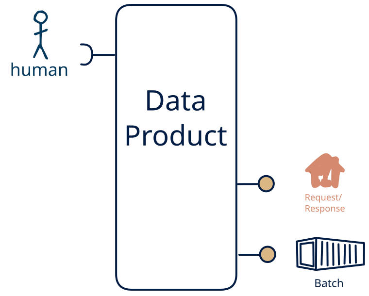

# 15.2 — human-only → query + file

**Interface:** IN {H} → OUT {B, R}&emsp;&emsp;**Verdict:** plausible

A product that takes human-produced data and serves bulk files and a query API. Human-entered data is the source; the product turns what people put in into bulk files and a query API for downstream use.

## When to use

Data originates with people (entry, review, curation) rather than a machine source, and the audience needs it as bulk files and a query API — the product is what stands between a person's editing and the consumer.

## What's inside

- Ingest: **human entry / curation** — data produced by people (forms, editors, review UIs), validated and audit-trailed on every change.
- Core: a light transform between ingest and serve
- Serve: a **publication job** that materialises bulk artifacts (files/bundles) with a manifest and as-of and a **query service** (the API surface) over the state store.
- State: a durable **state store**, the **retained bulk artifacts**, and an **audit trail** of human changes.

## State & cost

Dominated by the durable state store (grows with entity/state breadth), the retained bulk artifacts, and the audit trail of human edits. The cost is not infrastructure but discipline: human-entered data needs validation, provenance, and a correction path.

## Watch out

- Human-entered data is the softest input: it arrives irregularly, carries intent and errors, and needs **validation, provenance, and a correction path** — trust leans on the audit trail, not the schedule.

## Typical next step

add a **human-facing surface** → cell [15.9](/data-product-types/in-h-out-bhr) and add a **feed** → cell [15.1](/data-product-types/in-h-out-brs) (synthetic only if the human change is observed state rather than delivered actions — see [synthetic stream](/knowledge-concepts/synthetic-stream)); or the source world gains a leg this product does not yet take, and it migrates to a richer IN-state on the same row.

## Verdict

**plausible** — turning human-entered data into a downstream surface is sensible but project-shaped — a curation product, not a default pipe, and its demand is real where this audience exists.

## Related

* [batch](/knowledge-concepts/pattern-batch)
* [request/response](/knowledge-concepts/pattern-request-response)
* [human](/knowledge-concepts/pattern-human)
* [data-product](/knowledge-concepts/data-product) — the overall model
* [verdict](/knowledge-concepts/verdict) — what the common / plausible / niche tag means
