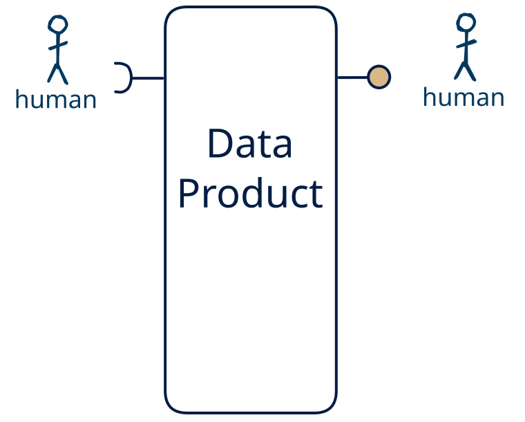

# 15.15 — Shared record (human in, human out)

**Interface:** IN {H} → OUT {H}&emsp;&emsp;**Verdict:** plausible

People enter the data (forms, editors, review) and people read the same data back (a report, a screen, a printout). This is the **pre-automation pattern**: the whole interface is person-to-person, no machine mediation on either side — analog in that sense, not in the sense of paper. The oldest data product there is: the ledger and the filing cabinet before automation, the Word document, the shared spreadsheet, and the wiki page today. Every other cell on this row — and most of the matrix — is a growth step out of it.

## When to use

The audience is a small group of people who both maintain and read the data — a team tracker, a manual register, an approval log — with no machine consumer at all.

## What's inside

- Ingest: **human entry / curation** — data produced by people (forms, editors, review UIs), validated and audit-trailed on every change.
- Core: a light transform between ingest and serve
- Serve: a **human-facing surface** — the shared document or spreadsheet itself, a report, a screen, a printout — the layer people actually read.
- State: a durable **state store** and an **audit trail** of human changes.

## State & cost

Dominated by the durable state store (grows with entity/state breadth) and the audit trail of human edits. Serving people is cheap to run and cheap to trust — a presentation layer over a queryable backend. The cost is not infrastructure but discipline: human-entered data needs validation, provenance, and a correction path.

## Watch out

- **Softness is a cost, not a value judgement.** Human-entered data is the softest input — irregular, subjective, error-prone, expensive to re-issue — so it needs **validation, provenance, and a correction path**, and trust leans on the audit trail, not the schedule. It is also the most expensive channel: where a machine source *can* carry the same meaning, prefer it, and keep the human leg for what only a person can supply.
- **Human input can be the value-driver.** Where the human act *is* the value — a judgement, a design intent, creative or social content, an accountable decision — and cannot be automated, human input is the **most valuable input** the product has, and the other legs exist to *enrich* it (see [the role of human input](/concepts/role-of-human-input)).
- A human-facing surface inherits the state behind it: the report/dashboard carries every as-of and correctness rule of the store, and a person spots a stale number faster than an API client will.

## Typical next step

The growth steps are the moment it stops being pre-automation: add a **query API** → cell [15.13](/data-product-types/in-h-out-rh), add a **bulk file** → cell [15.14](/data-product-types/in-h-out-bh), add a **feed** → cell [15.12](/data-product-types/in-h-out-sh) (a real event feed if the actions come through the product's own surface, synthetic only if the product diffs an observed state); or the source world gains a leg this product does not yet take, and it migrates to a richer IN-state on the same row.

## Verdict

**plausible** — A product that ingests human-authored data and serves a human-facing surface (a report, dashboard, or shared record the same people maintain). It is a natural fit where the human act *is* the value — a judgement, a decision, a curated record — so the softest, costliest channel is then the *cost of having that value*; where the act *could* be automated the cheaper machine path wins.

## Related

* [human](/concepts/pattern-human)
* [data-product](/concepts/data-product) — the overall model
* [verdict](/concepts/verdict) — what the common / plausible / niche tag means
