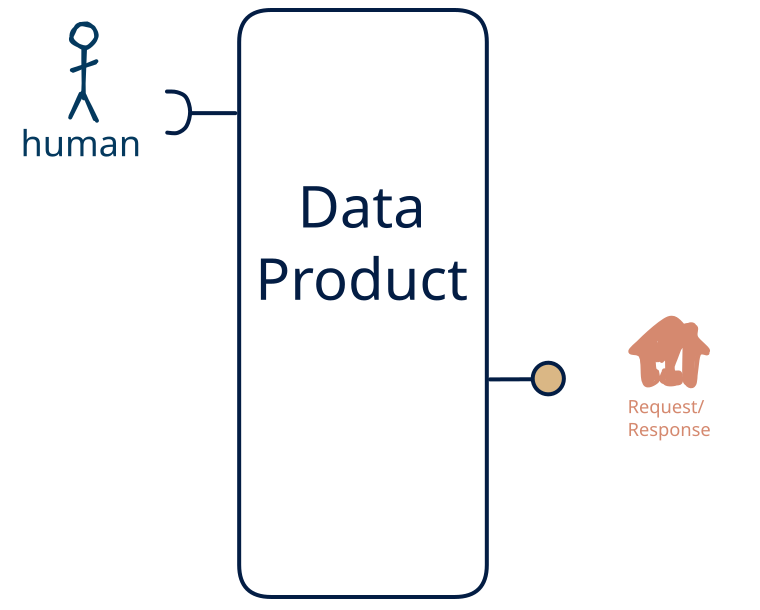

# 15.6 — human-only → request-response-only

**Interface:** IN {H} → OUT {R}&emsp;&emsp;**Verdict:** plausible

A product that takes human-produced data and serves a query API. Human-entered data is the source; the product turns what people put in into a query API for downstream use.

## When to use

Data originates with people (entry, review, curation) rather than a machine source, and the audience needs it as a query API — the product is what stands between a person's editing and the consumer.

## What's inside

- Ingest: **human entry / curation** — data produced by people (forms, editors, review UIs), validated and audit-trailed on every change.
- Core: a light transform between ingest and serve
- Serve: a **query service** (the API surface) over the state store.
- State: a durable **state store** and an **audit trail** of human changes.

## State & cost

Dominated by the durable state store (grows with entity/state breadth) and the audit trail of human edits. The cost is not infrastructure but discipline: human-entered data needs validation, provenance, and a correction path.

## Watch out

- **Softness is a cost, not a value judgement.** Human-entered data is the softest input — irregular, subjective, error-prone, expensive to re-issue — so it needs **validation, provenance, and a correction path**, and trust leans on the audit trail, not the schedule. It is also the most expensive channel: where a machine source *can* carry the same meaning, prefer it, and keep the human leg for what only a person can supply.
- **Human input can be the value-driver.** Where the human act *is* the value — a judgement, a design intent, creative or social content, an accountable decision — and cannot be automated, human input is the **most valuable input** the product has, and the other legs exist to *enrich* it (see [the role of human input](/concepts/role-of-human-input)).

## Typical next step

add a **human-facing surface** → cell [15.13](/data-product-types/in-h-out-rh), add a **bulk file** → cell [15.2](/data-product-types/in-h-out-br), and add a **feed** → cell [15.4](/data-product-types/in-h-out-rs) (synthetic only if the human change is observed state rather than delivered actions — see [synthetic stream](/concepts/synthetic-stream)); or the source world gains a leg this product does not yet take, and it migrates to a richer IN-state on the same row.

## Verdict

**plausible** — A product that ingests human-authored data and serves query APIs. It is a deliberate, project-shaped choice — not a default pipe — because human input is the softest and costliest channel, so where the value *could* be automated the machine path is preferred; where the human act *is* the irreplaceable value it is the most valuable input the product has and the machine legs exist to *enrich* it.

## Related

* [request/response](/concepts/pattern-request-response)
* [human](/concepts/pattern-human)
* [data-product](/concepts/data-product) — the overall model
* [verdict](/concepts/verdict) — what the common / plausible / niche tag means
