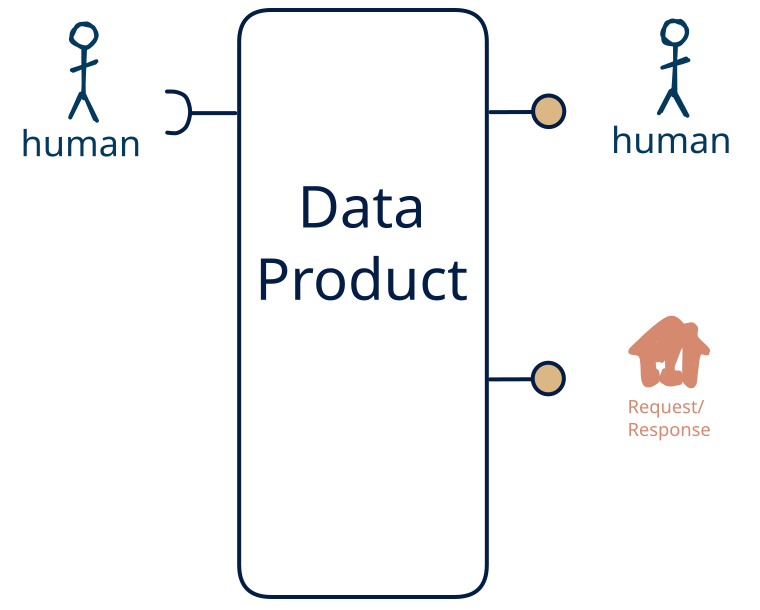

# 15.13 — human-only → API + human

**Interface:** IN {H} → OUT {R, H}&emsp;&emsp;**Verdict:** common

A product that takes human-produced data and serves a query API and a human-facing surface (dashboard/report). People both produce and read the data: the human pattern is on both sides.

## When to use

A small group of people both maintains and reads the data, with no machine consumer — a shared, human-scale record rather than an automated interface.

## What's inside

- Ingest: **human entry / curation** — data produced by people (forms, editors, review UIs), validated and audit-trailed on every change.
- Core: a light transform between ingest and serve
- Serve: a **query service** (the API surface) over the state store and a **human-facing surface** (dashboard, report, printout, or review screen) — the layer people actually read.
- State: a durable **state store** and an **audit trail** of human changes.

## State & cost

Dominated by the durable state store (grows with entity/state breadth) and the audit trail of human edits. The cost is not infrastructure but discipline: human-entered data needs validation, provenance, and a correction path.

## Watch out

- Human-entered data is the softest input: it arrives irregularly, carries intent and errors, and needs **validation, provenance, and a correction path** — trust leans on the audit trail, not the schedule.
- A human-facing surface inherits the state behind it: the report/dashboard carries every as-of and correctness rule of the store, and a person spots a stale number faster than an API client will.

## Typical next step

add a **bulk file** → cell [15.9](/data-product-types/in-h-out-bhr) and add a **feed** → cell [15.11](/data-product-types/in-h-out-rsh) (synthetic only if the human change is observed state rather than delivered actions — see [synthetic stream](/knowledge-concepts/synthetic-stream)); or the source world gains a leg this product does not yet take, and it migrates to a richer IN-state on the same row.

## Verdict

**common** — people both feed and read the data, so it is a natural product, and its demand is real where this audience exists.

## Related

* [request/response](/knowledge-concepts/pattern-request-response)
* [human](/knowledge-concepts/pattern-human)
* [data-product](/knowledge-concepts/data-product) — the overall model
* [verdict](/knowledge-concepts/verdict) — what the common / plausible / niche tag means
