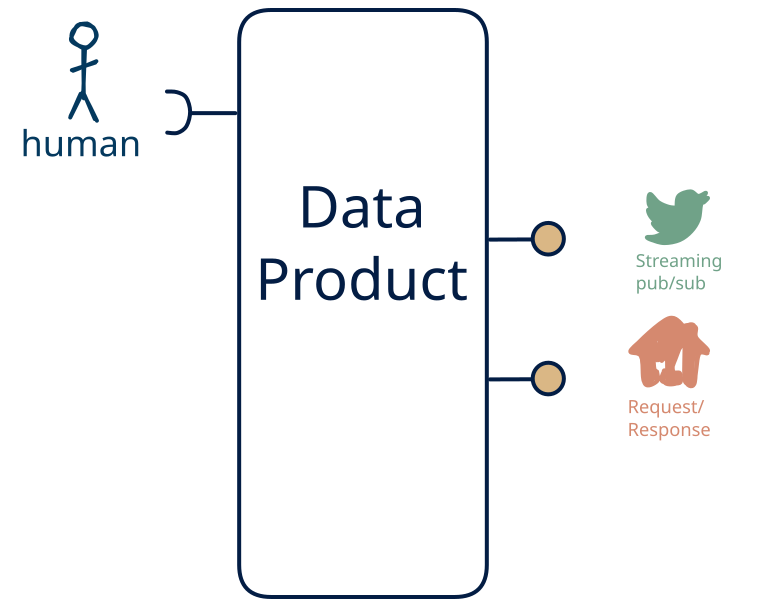

# 15.4 — human-only → live + lookup

**Interface:** IN {H} → OUT {R, S}&emsp;&emsp;**Verdict:** plausible

A product that takes human-produced data and serves a query API and a live feed. Human-entered data is the source; the product turns what people put in into a query API and a live feed for downstream use.

## When to use

Data originates with people (entry, review, curation) rather than a machine source, and the audience needs it as a query API and a live feed — the product is what stands between a person's editing and the consumer.

## What's inside

- Ingest: **human entry / curation** — data produced by people (forms, editors, review UIs), validated and audit-trailed on every change.
- Core: a **change-detection engine** that manufactures the feed off the non-streaming inputs
- Serve: a **query service** (the API surface) over the state store and a **change-detection layer** diffing each refresh, driving a **producer** (a *synthetic* feed).
- State: a durable **state store**, a **diff baseline**, the **feed log** (retention), and an **audit trail** of human changes.

## State & cost

Dominated by the durable state store (grows with entity/state breadth), the diff baseline plus the manufactured feed's log, and the audit trail of human edits. The cost is not infrastructure but discipline: human-entered data needs validation, provenance, and a correction path.

## Watch out

- Human-entered data is the softest input: it arrives irregularly, carries intent and errors, and needs **validation, provenance, and a correction path** — trust leans on the audit trail, not the schedule.
- The **feed is synthetic** (S out, not in): "change" is a computed diff bounded by the refresh cadence — pin what counts as a change, idempotency, and backfill.

## Synthetic stream

This cell serves **S** without taking **S** as input, so its stream is a **synthetic stream**: change-detection computed on top of a non-streaming source. The contract must pin down the five items (see [synthetic stream](/knowledge-concepts/synthetic-stream)):

1. **What counts as a "change"** — field-level, row version, or full snapshot?
2. **Latency bound** — bounded by the refresh cadence, not source event time.
3. **Idempotency** — re-polling / re-loading must not duplicate events.
4. **Backfill semantics** — how history is (re)issued after a gap or correction.
5. **Ordering** — whether the stream preserves source ordering at all.

## Typical next step

add a **human-facing surface** → cell [15.11](/data-product-types/in-h-out-rsh) and add a **bulk file** → cell [15.1](/data-product-types/in-h-out-brs); or the source world gains a leg this product does not yet take, and it migrates to a richer IN-state on the same row.

## Verdict

**plausible** — turning human-entered data into a downstream surface is sensible but project-shaped — a curation product, not a default pipe, and its demand is real where this audience exists.

## Related

* [request/response](/knowledge-concepts/pattern-request-response)
* [streaming](/knowledge-concepts/pattern-streaming)
* [human](/knowledge-concepts/pattern-human)
* [synthetic stream](/knowledge-concepts/synthetic-stream) — the pseudo-stream hazard
* [data-product](/knowledge-concepts/data-product) — the overall model
* [verdict](/knowledge-concepts/verdict) — what the common / plausible / niche tag means
