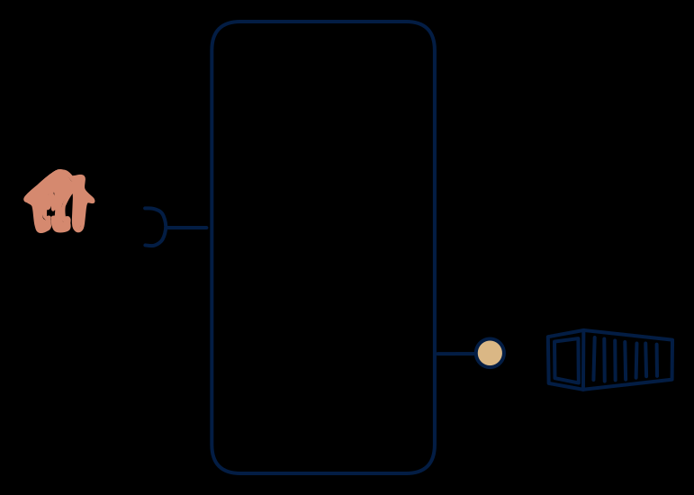

# 6.7 — API feed → scheduled file

**Interface:** IN `{R}` → OUT `{B}`&emsp;&emsp;**Verdict:** common

Poll from upstream, publish a file. The classic fetch-and-drop integration (supplier portal API → settlement file; tariff API → rate-table file). Poll an upstream, publish a file: the classic "fetch and drop" integration. A fetch-and-drop bridge — its value is completeness and schedule, not computation.

## When to use

The contract is file-based delivery; the source is API-based.

The contract with consumers is file delivery on a schedule, while the source is only reachable by API — supplier portals, tariff services, meter APIs.

## What's inside

- A **poller/connector** with a version cursor (last-seen anchor), retry and backoff policy.
- A **fetch-and-assemble** step: delta or full fetch, deduplication against the cursor.
- A **publication** step that builds and places the artifact with a manifest.
- State: the cursor plus the last published artifact.

## State & cost

Lightweight: a cursor, a staging area for the latest fetch, and artifact retention. No state store in the warehouse sense, no feed. Cost is dominated by the upstream's call limits and artifact size.

## Watch out

- Cursor management is the core risk: a lost or advanced cursor silently skips or duplicates records between cycles.
- The publish must be atomic per cycle (manifest first, or consumers half-load); a partial file read as a full file is the classic incident.

## Typical next step

Typical growths: an online consumer appears, and a query API over the fetched data is added (**cell 6.2**); a change-reactive consumer appears, and a synthetic change feed is layered on (**6.4**/**6.5**). The source adding a push feed migrates the product to **row 5**.

## Verdict

**common** — a workhorse fetch-and-drop bridge — cheap, universally understood, and the standard shape where the contract is a file and the source is an API.

## Related

* [batch](/concepts/pattern-batch)
* [request/response](/concepts/pattern-request-response)
* [data-product](/concepts/data-product) — the overall model
* [verdict](/concepts/verdict) — what the common / plausible / niche tag means
