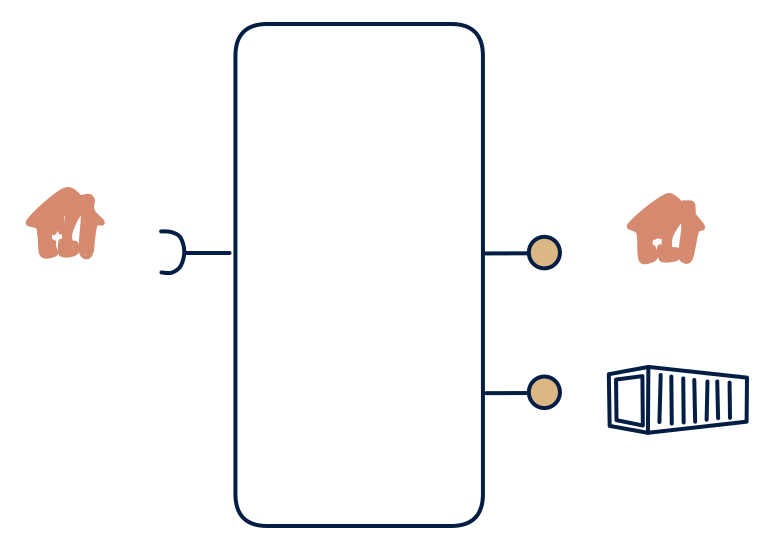

# 6.2 — Poll + serve API + files

**Interface:** IN `{R}` → OUT `{B, R}`&emsp;&emsp;**Verdict:** plausible

A refreshed service: polls upstream, exposes a cleaner API, and also emits periodic full-load files (supplier meter API → reading API + daily snapshot files). Poll a source, serve both a query API and periodic files: the refreshed-state cell of the polled world. The state store serves two surfaces — the freshest one (API) and the complete one (files).

## When to use

Consumers are a mix of online pollers + ETL consumers, and the upstream is API-only.

Consumers are a mix of online pollers and ETL consumers, and the upstream is API-only or file-plus-API with no push.

## What's inside

- A **poller/connector** with a version anchor (and, if needed, a file leg for the batch part of the input).
- A **transform + load** into the state store — the refreshed canonical state.
- A **query service** (API) and a **publication job** (scheduled files) over the same store.
- State: the store, the anchor, the last artifact.

## State & cost

Store plus artifact retention — the same profile as a warehouse fed by batch, but the ingest path is a continuous poll. The anchor (version cursor) must survive restarts; losing it can force a full re-fetch the upstream may not allow.

## Watch out

- The API and the file surfaces must agree on as-of: derive both from the same committed state, or consumers see two different "trues".
- Upstream rate limits bound how fresh the state can be; freshness SLAs must be expressed in poll cycles, not seconds.

## Typical next step

The natural growth is a change-reactive consumer: add a synthetic change feed over the anchor and the product becomes **cell 6.1**. More inputs (a file source, a push feed) migrate the product to **row 1**/**row 2**/**row 4**.

## Verdict

**plausible** — the classic refreshed-state hub over a polled world — one store, two surfaces, and the anchor as the product's key state.

## Related

* [batch](/knowledge-concepts/pattern-batch)
* [request/response](/knowledge-concepts/pattern-request-response)
* [data-product](/knowledge-concepts/data-product) — the overall model
* [verdict](/knowledge-concepts/verdict) — what the common / plausible / niche tag means
