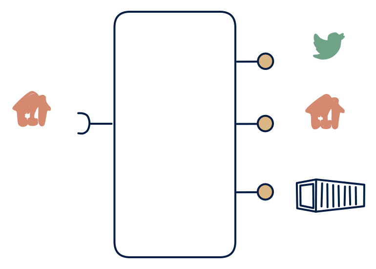

# 6.1 — Polling facade with synthetic stream

**Interface:** IN `{R}` → OUT `{B, R, S}`&emsp;&emsp;**Verdict:** niche

Polls upstream, computes deltas, serves file + API + a *synthetic* change stream. A polling facade with all three output surfaces: query API, files, and a synthetic change feed. The heaviest polled-world cell — the feed is the manufactured part.

## When to use

The source world is file/API-only and downstream is event-driven.

The source world is file/API-only and downstream spans all three consumer families, including strongly event-driven ones.

## What's inside

- A **poller/connector** with a version anchor.
- A **transform + load** into the state store.
- A **diff/change layer** driving a **producer** (the synthetic feed).
- A **query service** and a **publication job** (files) over the store.
- State: store, anchor, diff baseline, feed log, last artifact.

## State & cost

Heaviest polled cell in the space: store, anchor, diff baseline, feed log, and artifacts. The synthetic feed is the expensive-to-trust part — everything else in this cell is a standard serving stack.

## Watch out

The product owns change-detection semantics + backfill rules; the "stream" is an illusion over polling cadence.

- The feed's "change" is a diff between polls: changes that occur and revert within one poll cycle are invisible to feed consumers. That is a semantic gap, not a bug — document it.
- Three surfaces over one polled state triple the consistency surface: any anchor, load, or diff failure degrades all three at once.

## Synthetic stream

This cell's stream **out** is not backed by a stream **in** — it is a **synthetic stream**: change-detection computed on top of a non-streaming source. The contract must pin down five things (see [synthetic stream](/concepts/synthetic-stream)):

1. **What counts as a "change"** — field-level, row version, or full snapshot?
2. **Latency bound** — bounded by the poll/refresh cadence, not the source's event time.
3. **Idempotency** — re-polling / re-loading must not duplicate events.
4. **Backfill semantics** — how history is (re)issued after a gap or correction.
5. **Ordering** — whether the stream preserves source ordering at all.

## Typical next step

Pattern space is exhausted at this corner; growth is horizontal (new domains on the same facade) or a source-side upgrade (a push feed replaces polling, migrating the product toward **row 4**). Common contraction: the feed — the most expensive trust surface — is the first to be dropped, yielding **6.2**.

## Verdict

**niche** — plausible as the full-surface polled facade — met where all three consumer families are real and the source stays poll-only.

## Related

* [batch](/concepts/pattern-batch)
* [request/response](/concepts/pattern-request-response)
* [streaming](/concepts/pattern-streaming)
* [synthetic-stream](/concepts/synthetic-stream) — this cell's stream out is not backed by a stream in
* [data-product](/concepts/data-product) — the overall model
* [verdict](/concepts/verdict) — what the common / plausible / niche tag means
