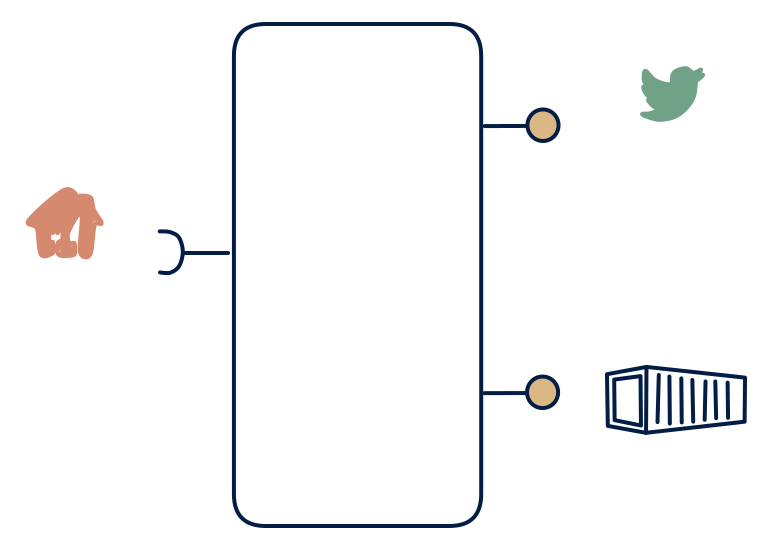

# 6.3 — Poller with stream + files

**Interface:** IN `{R}` → OUT `{B, S}`&emsp;&emsp;**Verdict:** niche

API in, stream out (synthetic) + files out — a bridge from a polled world into a streaming world plus an archival file set. Poller with a synthetic feed and file publication, but no strong query surface: a bridge from a polled world into a streaming one, with an archive tail. The feed is the product's centre of gravity.

## When to use

Downstream wants push and archives; source is poll-only.

Downstream wants push and archives, and the source is poll-only — a device-registry or market-page world feeding a stream-driven estate.

## What's inside

- A **poller/connector** with a version anchor.
- A **diff layer** over successive fetches driving the **producer** (synthetic feed).
- A **publication job** for the archive files.
- State: anchor, diff baseline, feed log, last artifact.

## State & cost

Anchor plus diff baseline plus feed log plus artifacts — like the 6.1 cell without a strong query store. The snapshot must be whole (the diff needs it), so the working store is sized for a full fetch, not a delta.

## Watch out

Synthetic-stream caveats apply (change semantics, cadence, backfill).

- Feed consumers will assume continuous delivery; in reality events arrive in poll-sized bursts. State the burst cadence in the contract.
- Archive files and the feed describe the same data at different times; a consumer using both needs the as-of mapping, which is easy to under-spec.

## Synthetic stream

This cell's stream **out** is not backed by a stream **in** — it is a **synthetic stream**: change-detection computed on top of a non-streaming source. The contract must pin down five things (see [synthetic stream](/concepts/synthetic-stream)):

1. **What counts as a "change"** — field-level, row version, or full snapshot?
2. **Latency bound** — bounded by the poll/refresh cadence, not the source's event time.
3. **Idempotency** — re-polling / re-loading must not duplicate events.
4. **Backfill semantics** — how history is (re)issued after a gap or correction.
5. **Ordering** — whether the stream preserves source ordering at all.

## Typical next step

Typical growth: a query surface for online consumers yields **cell 6.1** (full feed+file+query) or **6.4** (feed+query). A source-side push feed migrates the product to **row 5**/**row 4** and retires the poller — usually the end-state.

## Verdict

**niche** — a bridge cell: sensible where the estate is stream-first and the source is poll-only; the synthetic feed and archive duplication keep it in the plausible tier.

## Related

* [batch](/concepts/pattern-batch)
* [request/response](/concepts/pattern-request-response)
* [streaming](/concepts/pattern-streaming)
* [synthetic-stream](/concepts/synthetic-stream) — this cell's stream out is not backed by a stream in
* [data-product](/concepts/data-product) — the overall model
* [verdict](/concepts/verdict) — what the common / plausible / niche tag means
