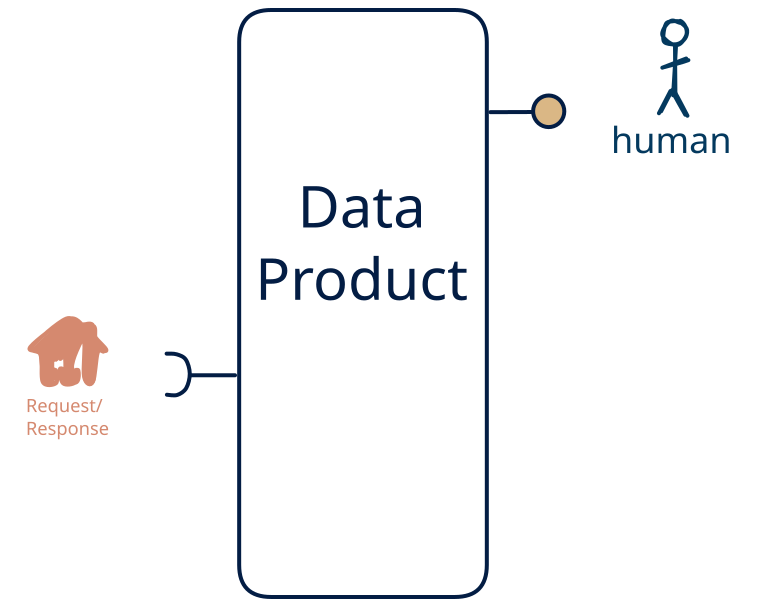

# 6.15 — request-response-only → human-only

**Interface:** IN {R} → OUT {H}&emsp;&emsp;**Verdict:** common

A product that takes on-demand APIs and serves a human-facing surface (dashboard/report). Machine-side inputs ({R}) drive it — a report or dashboard is the product, not the pipe.

## When to use

The data the audience wants is real, but the reader is a person, not a service: they need a report or dashboard over a single leg of upstream APIs, not raw events or a bulk drop.

## What's inside

- Ingest: a **poller/connector** over the upstream API (version anchor, pagination, retry).
- Core: a light transform between ingest and serve
- Serve: a **human-facing surface** (dashboard, report, printout, or review screen) — the layer people actually read.
- State: a durable **state store**.

## State & cost

Dominated by the durable state store (grows with entity/state breadth). Serving people is cheap to run and cheap to trust — a presentation layer over a queryable backend.

## Watch out

- A human-facing surface inherits the state behind it: the report/dashboard carries every as-of and correctness rule of the store, and a person spots a stale number faster than an API client will.
- This is machine-produced, human-read: make sure a person actually reviews/approves the served view rather than the pipeline writing it straight through.

## Typical next step

add **human curation on the input side** → cell [13.15](/data-product-types/in-rh-out-h) when the data should not be purely machine-fed, add a **query API** → cell [6.13](/data-product-types/in-r-out-rh), and add a **bulk file** → cell [6.14](/data-product-types/in-r-out-bh); or the source world gains a leg this product does not yet take, and it migrates to a richer IN-state on the same row.

## Verdict

**common** — A product that ingests query APIs and serves a human-facing surface (a report, dashboard, or shared record the same people maintain). It is the right shape where the reader is a person rather than a service, and the human-shaped view is itself what the next consumer — or the next machine in the loop — needs to act on.

## Related

* [request/response](/concepts/pattern-request-response)
* [human](/concepts/pattern-human)
* [data-product](/concepts/data-product) — the overall model
* [verdict](/concepts/verdict) — what the common / plausible / niche tag means
