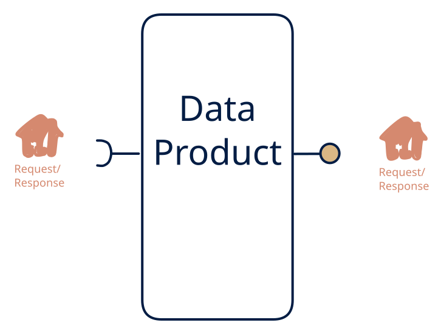

# 6.6 — API proxy / facade

**Interface:** IN `{R}` → OUT `{R}`&emsp;&emsp;**Verdict:** common

The cleanest "value = a better surface" product: normalise schemas, add caching/semantics, hide auth quirks, serve one clean API (OData/ESDP façade over supplier REST). The cleanest "value is the better surface" product: one canonical API over a set of upstream APIs and reference files. A diagonal cell — IN = OUT — so the value is normalisation, semantics, auth, and freshness, not data conversion.

## When to use

No transformation-heavy load; value is integration experience (canonical schema + auth + semantics).

When the value is the integration experience: a tariff or device API over supplier web services plus rate tables, or a canonical master-data API over a pile of upstream endpoints.

## What's inside

- Connectors per upstream (pollers, file readers) with **version anchors**.
- A **normalisation layer** mapping upstream schemas onto the canonical model.
- A **cache/state layer** holding the latest known value per key (freshness is a policy, not an accident).
- A **canonical API** (auth, pagination, versioning) as the sole surface.
- State: the cache and the anchors — bounded, per-key, not warehouse-scale.

## State & cost

Bounded by cardinality, not history: the cache holds the latest known value per key, so the state cost is small and stable. No feed, no artifacts. The real cost lives in the upstream's quotas and schema churn, not in this product's infrastructure.

## Watch out

- Caching turns the facade into a stateful product the moment an anchor or cache entry goes stale — staleness policy is part of the contract, not an implementation note.
- Upstream schema changes propagate through the normalisation layer silently; a contract test per upstream is the cheapest protection.

## Typical next step

Growth is adding surfaces: file/ETL consumers appear and publication is added (**cell 6.2**/**6.7**); reactive consumers appear and a synthetic change feed is layered on (**6.4**/**6.5**). Input-side growth (more upstreams, a push feed) moves the product up a row without changing its nature.

## Verdict

**common** — the highest-value-per-cost facade in the space: thin state, outsized integration value — the default choice for normalising a messy upstream API world.

## Related

* [request/response](/concepts/pattern-request-response)
* [data-product](/concepts/data-product) — the overall model
* [verdict](/concepts/verdict) — what the common / plausible / niche tag means
* [architectural paradigms](/concepts/architectural-paradigms) — this cell maps to: API gateway / microservices facade: a thin normalising proxy over upstream APIs.
