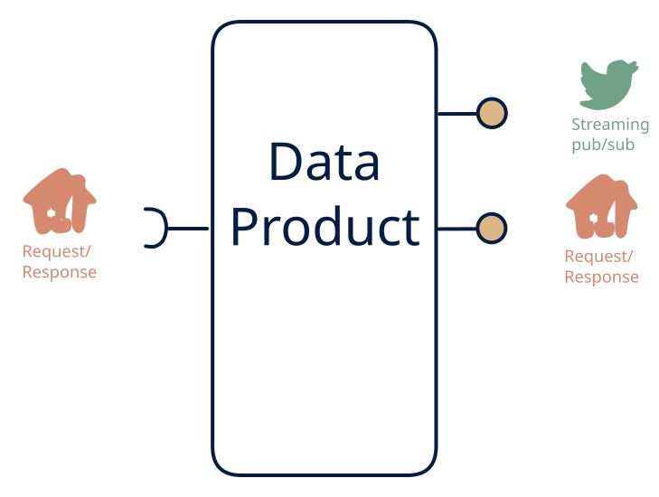

# 6.4 — Poll-derived live + query

**Interface:** IN `{R}` → OUT `{R, S}`&emsp;&emsp;**Verdict:** niche

API poll in, live feed + API out. "Live" over a polled world. A live facade over a polled world: a query API plus a synthetic feed, both derived from the refresh. "Live" here is bounded by the poll cadence — the feed is a diff, not a stream.

## When to use

Consumers want push + query, the only source is pollable.

A dashboard or downstream service wants both to query state and to react to change, while the only source is a scheduled poll (device registries, market pages).

## What's inside

- A **poller** with a version anchor (the only input).
- A **transform + load** into the state store (feeds the API).
- A **diff layer** driving a **producer** (the synthetic feed).
- State: store, anchor, diff baseline, feed log.

## State & cost

Store plus feed log plus anchors/baselines — the query store and the feed together roughly double the durable footprint versus cell 6.6 alone. The anchor and diff baseline must be retained for idempotent re-emission after a failure.

## Watch out

Latency bounded by poll cadence; freshness stamps required.

- Every data point must carry a freshness stamp; polling latency is the truth, and a consumer assuming sub-second freshness is a support ticket.
- The diff is only as correct as the anchor: a skipped poll produces a silent hole in the feed that consumers will not detect on their side.

## Synthetic stream

This cell's stream **out** is not backed by a stream **in** — it is a **synthetic stream**: change-detection computed on top of a non-streaming source. The contract must pin down five things (see [synthetic stream](/knowledge-concepts/synthetic-stream)):

1. **What counts as a "change"** — field-level, row version, or full snapshot?
2. **Latency bound** — bounded by the poll/refresh cadence, not the source's event time.
3. **Idempotency** — re-polling / re-loading must not duplicate events.
4. **Backfill semantics** — how history is (re)issued after a gap or correction.
5. **Ordering** — whether the stream preserves source ordering at all.

## Typical next step

Adding bulk publication yields **cell 6.1** (the full facade); more reference inputs (a file leg) broaden IN toward **row 2**. The clean long-run move is a source upgrade to a push feed, which migrates the product to **row 4** and makes the feed real.

## Verdict

**niche** — plausible as a bridge for dashboard-grade freshness over a poll-only world; the synthetic feed is the cost that keeps it niche-to-plausible, not common.

## Related

* [request/response](/knowledge-concepts/pattern-request-response)
* [streaming](/knowledge-concepts/pattern-streaming)
* [synthetic-stream](/knowledge-concepts/synthetic-stream) — this cell's stream out is not backed by a stream in
* [data-product](/knowledge-concepts/data-product) — the overall model
* [verdict](/knowledge-concepts/verdict) — what the common / plausible / niche tag means
